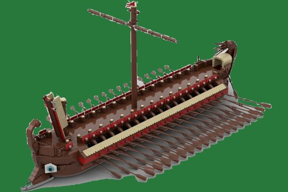
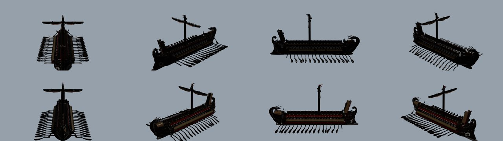
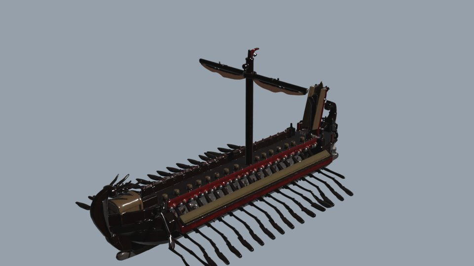
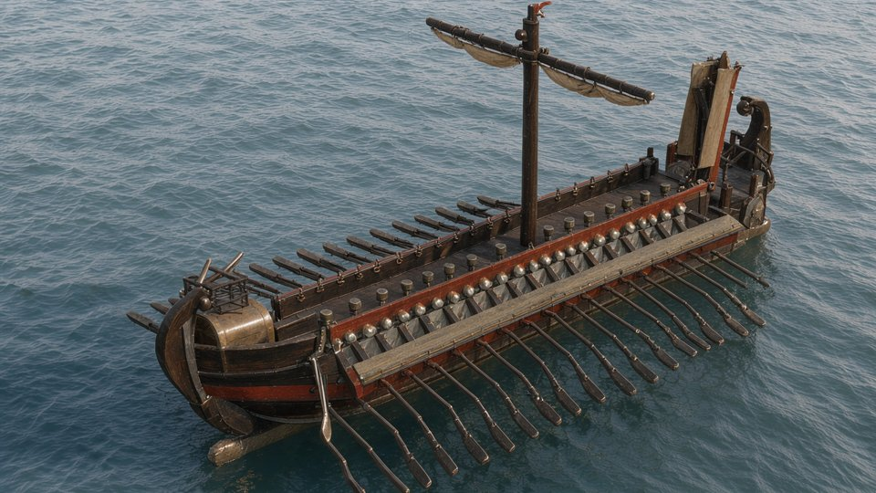

# Spike 2026-10-23: 3D model z předlohy (TRELLIS 2) → Blender → lokální FLUX

Operátor: „zda TRELLIS, když vygeneruje z podkladových obrázků 3D správně, tak pak může dostat správně zadání i náš generátor … navíc se nám to hodí kdekoli, kde budeme vytvářet 3D scénu, ve spolupráci s Blenderem.“ Schválil Blender a nejvýš 2 běhy TRELLIS 2 po 0,30 USD.

Proč: lokální FLUX 3 Klein kreslil kvinqueremu deformovaně (dva stěžně, vesla různé délky, směru i rozestupu). Lepší prompt ani termdb tvar nespraví.

## Postup a výsledek

| Krok | Nástroj | Cena | Čas |
|---|---|---|---|
| 1. Výřez předlohy (světlé šedé pozadí → alfa, flood fill od okrajů) | `scripts/3d/cutout.py` | 0 | <1 s |
| 2. Obrázek → 3D (GLB, 21,6 MB, 1024p, seed 7) | fal `fal-ai/trellis-2`, `scripts/3d/trellis_run.py` | 0,30 USD | 88 s |
| 3. Import GLB, kamera, světlo, render 1280×720 | Blender 5.2.3 LTS headless, `scripts/3d/render_glb.py` | 0 | ~40 s / 8 pohledů |
| 4. Render jako `role: geometry` předloha, anglický prompt, `translate: off` | Engine, lokální FLUX 3 Klein (job `20261023-115724-5a9c21`) | 0 | ~2 min / 2 obrázky |

Celkem 0,30 USD (zapsáno v `library/costs.jsonl`, caller `spike-3d`). Druhý běh TRELLIS nebyl potřeba.

## Zjištění

- **TRELLIS 2 udržel tvar ze všech stran:** jeden stěžeň s ráhnem, pravidelná vesla na obou bocích (stejná délka, úhel i rozestup), kloun, zakřivená záď, žádné slité tvary. Tenká vesla nezmizela, přestože jsme se toho báli.
- **FLUX podle renderu (geometry ref) tvar převzal:** jeden stěžeň a pravidelná vesla, loď na moři, materiály dřevo a bronz. Oproti dřívější generaci bez předlohy je to zásadní posun.
- **Model kopíruje předlohu, ne historii.** Předloha je zjednodušená stavebnicová loď s jednou řadou vesel na bok. Rekonstrukce kvinqueremy (Morrison) má tři řady vesel. Na historickou správnost je potřeba předloha s více řadami vesel, nebo doplnit řady vesel v Blenderu skriptem.
- Materiál z TRELLIS je lesklý tmavý plast; v Blenderu je potřeba světlejší svět (`Background` 2.0), slunce 5 a `view_transform = Standard`, jinak je render skoro černý.
- TRELLIS 2 bere jen jeden obrázek (`image_url`); `fal-ai/trellis/multi` (více pohledů) má nejasnou cenu „0,02 USD za jednotku“, nezkoušeno.
- Lokálně TRELLIS nepojede: Linux, ≥16 GB VRAM; notebook má RTX 4060 8 GB.

## Instalace

Blender 5.2.3 LTS portable: `C:/Users/stock/tools/blender-5.2.3-windows-x64/blender.exe` (zip z download.blender.org, SHA256 ověřený proti `blender-5.2.3.sha256`).

## Data

Model a předloha: `library/3d/kvinquerema-trellis2/` (`model.glb`, `model.json` s proveniencí, `predloha.png`, `render-az225.png`).
