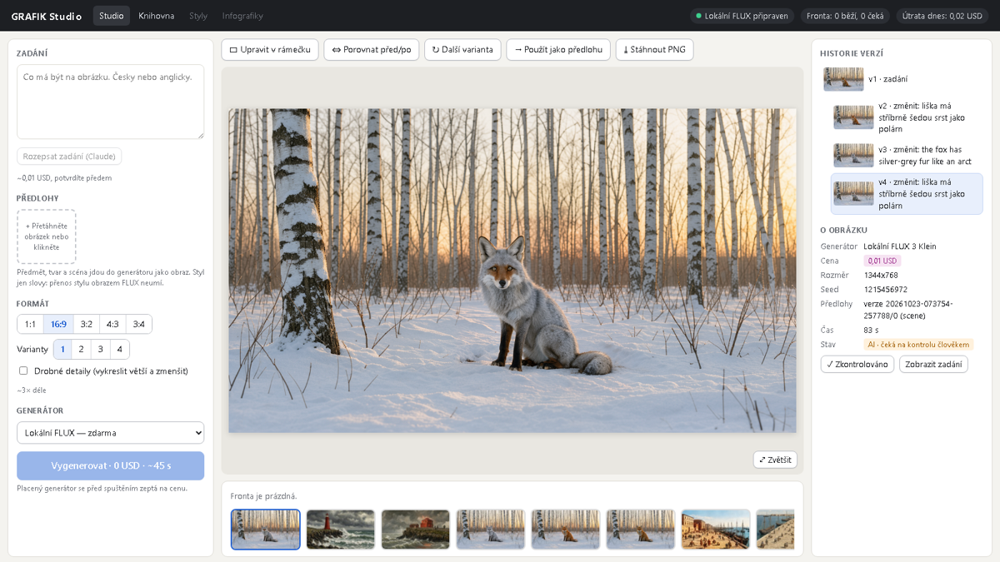
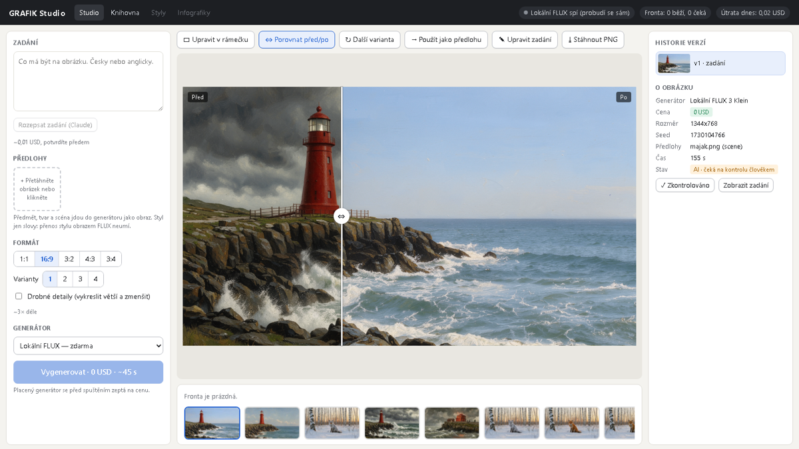
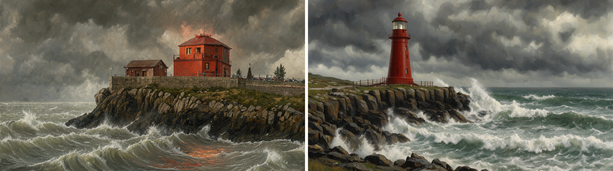

# G2 — GRAFIK Studio: ověření klikáním (2026-10-23)

Spec: `docs/plans/2026-10-22-grafik-v2-greenfield.md` § 2 (sc-10…sc-15). Náčrt schválený operátorem: [`img/g2-nacrt.png`](img/g2-nacrt.png).
Studio `studio/` (React + Vite) na :5174, `/api` proxy na Engine :8300. Engine i studio z větve `claude/grafik-g2-studio`, klikání ve vestavěném prohlížeči a v Playwright (Chromium). Útrata: **0,02 USD** (dva překlady přes Claude, se svolením operátora), generování lokálně zdarma.

| Krit. | Co | Výsledek |
|---|---|---|
| sc-10 | prompt → stav fronty → výsledek v galerii, zvětšitelný náhled | **PASS** — „Vygenerovat · 0 USD · ~45 s“, fronta „Běží“ s průběhem, po 41 s se liška sama vybrala; klik na obrázek = lightbox, „1:1“ ukáže skutečnou velikost, Esc zavře |
| sc-11 | obraz → obraz: nahrát obrázek, instrukce, porovnání před/po posuvníkem | **PASS** — nahraný maják (role scéna) → „klidný letní den“; posuvník porovnává s předlohou (`/api/v2/jobs/{id}/refs/0`) |
| sc-12 | 2–4 varianty jedním klikem, výběr | **PASS** — „Vygenerovat 2 varianty · 0 USD · ~3 min“, hotovo za 155 s, obě v galerii; vybraná se otevře, ostatní zůstávají |
| sc-13 | úprava v rámečku, mimo rámeček beze změny | **PASS** — rámeček tažením, „Přebarvit / změnit“, liška stříbrně šedá; průměrný rozdíl **mimo rámeček 0,000** (uvnitř 12–14) |
| sc-14 | historie verzí, návrat k libovolné verzi | **PASS** — strom v1 → v2/v3/v4 (sourozenecké úpravy), klik na v1 ji vrátí do náhledu |
| sc-15 | rozepsání zadání (Claude), vidět a upravit před odesláním | **PASS offline** (402 → potvrzení → text do pole; test `test_prompt_expand_needs_confirmation`); naostro neklikáno, aby nevznikla další útrata |

Další: kontrola člověkem („✓ Zkontrolováno“ → provenience `reviewed_by`), knihovna (14 obrázků, klik otevře ve studiu), 0 chyb v konzoli.

## Čeština: FLUX jí rozumí jen zhruba → překladová vrstva

Ověřeno na FLUX 3 Klein Q4 tentýž den:

| Vstup | Výsledek |
|---|---|
| úprava v rámečku česky „liška má stříbrně šedou srst jako polární liška“ | liška zůstala rezavá (rozdíl v rámečku 6,7) |
| tatáž úprava anglicky „the fox has silver-grey fur like an arctic fox“ | liška stříbrně šedá (rozdíl 13,8) |
| obrázek česky „Červený maják na skalnatém pobřeží za bouře…“ | barva, bouře, vlny i olejomalba sedí, **z majáku je dům** |

Vlevo původní liška, uprostřed český pokyn bez překladu, vpravo český pokyn po překladu:

Maják: vlevo česky bez překladu, vpravo po překladu („A red lighthouse on a rocky coastline during a storm…“):

Na pokyn operátora proto Engine překládá každé české textové pole (zadání, pokyn k úpravě, popis stylu) do angličtiny laděné pro cílový generátor (`engine/translate.py`: FLUX = popisná próza, Gemini/Nano Banana = jasné instrukce; značky `<ref_image_0>` a `<edit_1>` beze změny). Pozná ho podle české diakritiky. Cena ~0,01 USD (Claude Haiku) je v odhadu; stejný text podruhé se vezme z `library/translations.jsonl` zdarma. Ve studiu je cena v tlačítku („Vygenerovat · 0,01 USD za překlad“) a kliknutí je souhlas (rozhodnutí 2026-10-23); placený generátor dál otevírá dialog. Klienti mimo studio musí poslat `confirm_cost`, jinak 402; `translate: "off"` překlad vypne.

## Odhad času

Úprava s předlohou trvá ~1,9× déle než text → obraz stejné velikosti (1,03 MP: 41 s vs 79–84 s). Odhad v Engine i ve studiu s tím počítá.
