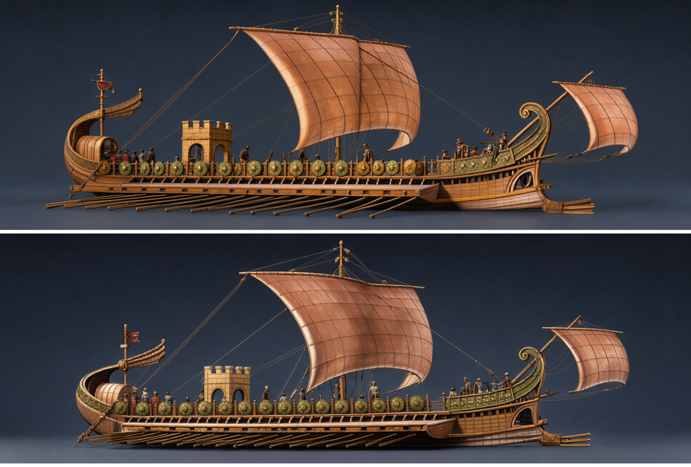
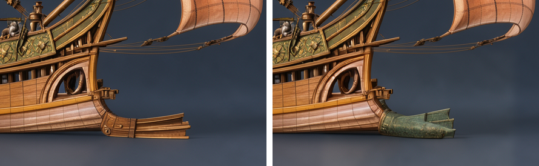
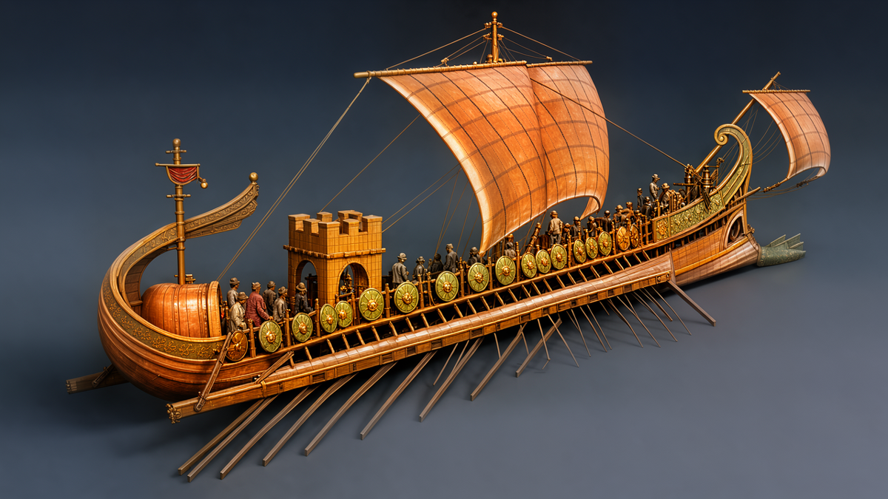
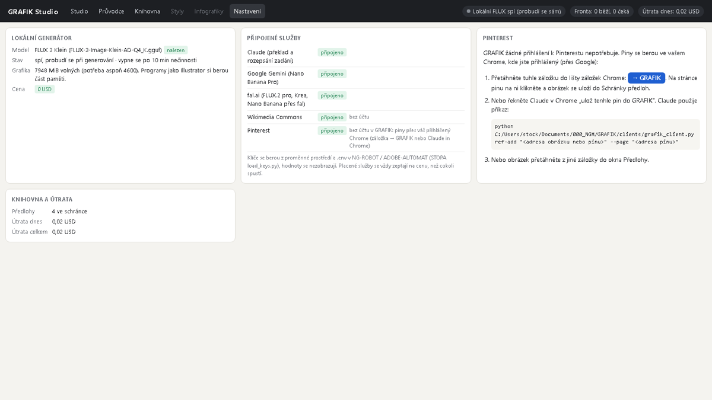

# G3 — předlohy a průvodce historickým objektem: ověření (2026-10-23)

Spec: `docs/plans/2026-10-22-grafik-v2-greenfield.md` sc-16…sc-19. Náčrty schválil operátor 23. 10. (okno „Přidat předlohu“ a záložka „Průvodce“; obrázky náčrtu nejsou v repu, obsahují cizí náhledy z Commons). Engine a studio z větve `claude/grafik-g3-predlohy`, klikání v Playwright (Chromium) a ve vestavěném prohlížeči. Útrata **0 USD** (popis objektu anglicky, vše lokálně).

| Krit. | Co | Výsledek |
|---|---|---|
| sc-16 | předloha z Wikimedia Commons hledáním v UI, uložená s licencí a autorem | **PASS** — „roman warship model“ → 6 obrázků (bez PDF díky `filetype:bitmap`); „+ Přidat“ stáhne zmenšenou verzi (2048 px) do schránky; v zadání štítky „Commons · CC BY-SA 4.0“ a „Commons · CC BY-SA 3.0“, v provenienci `author`, `license`, `ref_id` |
| sc-17 | předloha z Pinterestu do knihovny s adresou zdroje | **PASS** — záložka „→ GRAFIK“ (studio `#addref=…`) uložila obrázek z `i.pinimg.com` jako Pinterest, licence „neznámá — jen předloha“, štítek „nové“; cesta pro Claude in Chrome `grafik_client.py ref-add <url> --page <pin>` uložila druhý pin; přetažení obrázku z jiné záložky jde stejnou cestou (`text/uri-list`). Neexistující pin → čitelná chyba |
| sc-18 | role předlohy ovlivní prompt a provenienci | **PASS** (G1/G2 + testy): tvar/předmět/scéna jdou jako obraz, styl slovy; role a zdroj v provenienci |
| sc-19 | průvodce předloha → bokorys → oprava v rámečku → natočený pohled | **PASS** — viz níže |

## Průvodce na kvinquereme

Předlohy: „Pin 2“ (ilustrace z boku, role tvar) + Commons NMMI IMG 8747 (muzejní model, Deror avi, CC BY-SA 3.0, role předmět).

**Krok 2, čistý bokorys** (1920×640, 2 varianty, 322 s):

**Krok 3, oprava v rámečku**: beranidlo na přídi vyšlo jako vidlice (stejná chyba jako 22. 10.). Rámeček kolem něj + „změnit: solid cast bronze sheath … three flat horizontal fins“. Vlevo před, vpravo po; mimo rámeček rozdíl **0,0**:

**Krok 4, natočený pohled** 3/4 shora zleva, tmavé studio, render 1920×1072 → 1280×720 (2 varianty, ~5 min). Věž, štíty, vesla i opravené beranidlo drží; drobné postavy nejsou deformované:

Krok 5 (popisky) odkazuje na G5; „Otevřít ve studiu“ vede do stromu verzí.

## Nálezy

- **Paměť GPU:** první pokus o bokorys spadl na nedostatek VRAM. sd-server posílá předlohy v nativním rozlišení (Commons foto 2048×1028) a souběžně běžel Illustrator (Beta) a aplikace ChatGPT (~2,5 GB). Opravy: předlohy dohromady ~1,1 MP (`FluxLocal.fit_refs`), při OOM restart vlastního sd-serveru a nový pokus (v logu `stop sd-server … reason=málo paměti na GPU, restart a nový pokus`, druhý pokus doběhl), práh volné paměti 4,6 GB. Operátor pak Illustrator zavřel.
- **Pinterest** ve vestavěném prohlížeči chce přihlášení. Do účtu se nepřihlašuji; záložka a Claude in Chrome běží v operátorově přihlášeném Chrome (přes Google). `i.pinimg.com` obrázky jsou veřejné.
- **Tlačítko pod kurzorem:** obecný styl `.btn:hover` přebíjel modrou u hlavních tlačítek (bílý text na světlém). Opraveno, ověřeno `getComputedStyle` → `rgb(25, 79, 176)`.

## Karta Nastavení (požadavek operátora 23. 10.)

Záložka „Nastavení“: lokální generátor (model nalezen, stav, volná VRAM), připojené služby (Claude, Gemini, fal: klíč nalezen ano/ne, **hodnoty se nezobrazují**; Commons a Pinterest „bez účtu“), návod pro Pinterest se záložkou „→ GRAFIK“ a příkazem pro Claude in Chrome, útrata. Hesla ani klíče se v GRAFIK nezadávají: klíče jsou v `.env`, Pinterest jde přes Chrome.

Testy: `pytest tests/` 264 passed (G3: knihovna, Commons, pin `og:image`, `ref_id`, průvodce, překlad objektu, rozpočet předloh, OOM restart, nastavení bez hodnot klíčů); `npm run build` OK; 0 chyb v konzoli.
