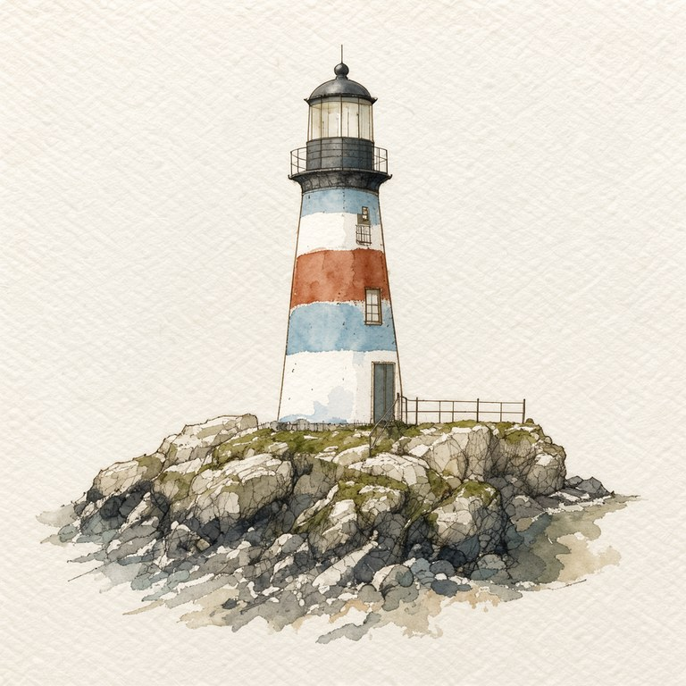
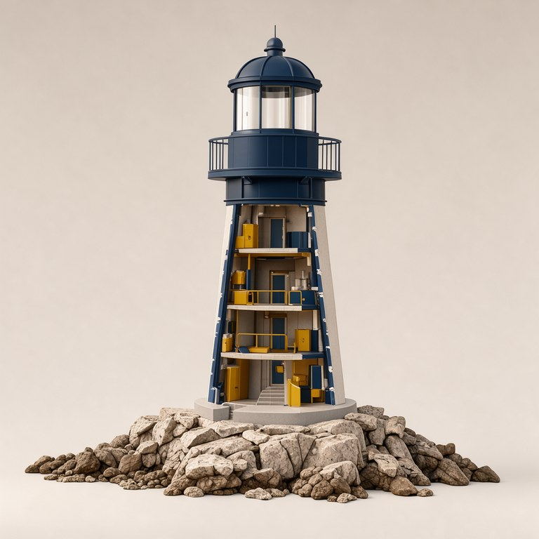
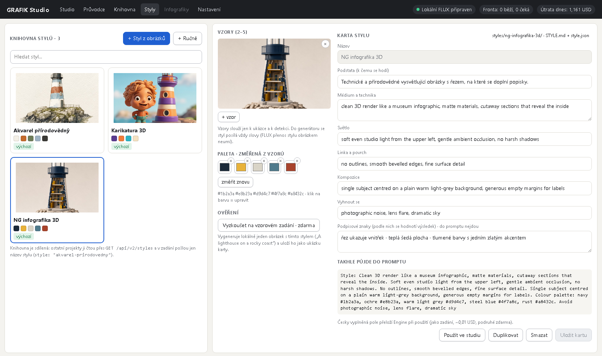
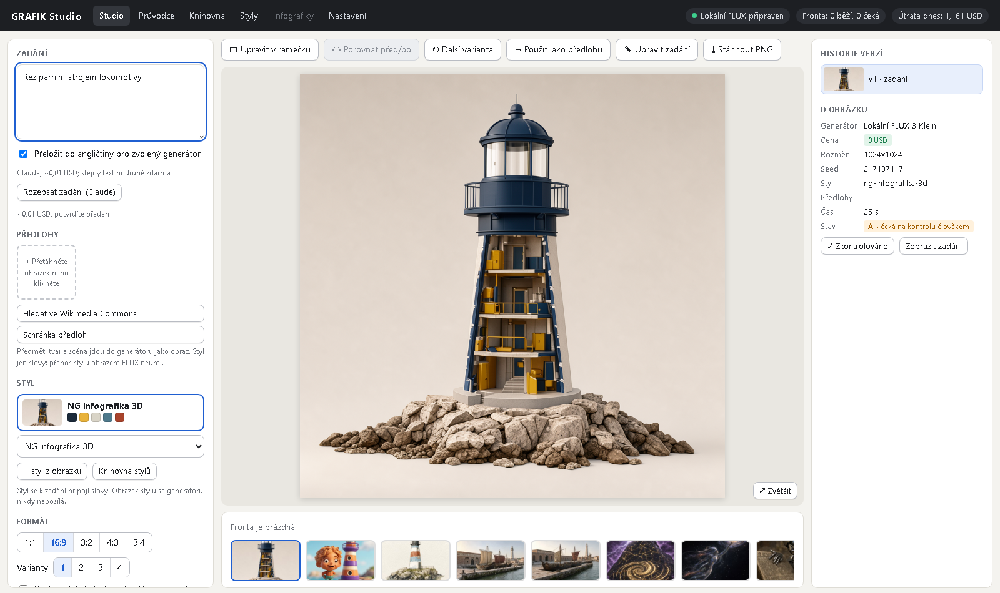

# G4 — styly: ověření (2026-10-23)

Spec: `docs/plans/2026-10-22-grafik-v2-greenfield.md` sc-20…sc-23. Náčrt schválil operátor 23. 10. ([1](img/g4-nacrt-1.png), [2](img/g4-nacrt-2.png)). Engine z větve `claude/grafik-g4-styly` na :8300 nad daty hlavního checkoutu, studio z větve na :5175, klikání ve vestavěném prohlížeči. Útrata **0 USD** (vše lokálně, placený „Popsat styl“ neklikán, viz níže).

| Krit. | Co | Výsledek |
|---|---|---|
| sc-20 | z obrázku vznikne karta (`STYLE.md` + `style.json`), paleta z pixelů (k-means), popis od Claude | **PASS offline + klikání bez Claude.** Dialog „Nový styl z obrázků“: obrázek ze studia → paleta 6 barev hned a zdarma → název → „Otevřít v kartě stylu“ → uložit; karta i vzor na disku. Popis přes Claude (`POST /api/v2/styles/describe`, 402 bez souhlasu, 0,01 USD) ověřen testy s podvrženou odpovědí; živě neklikán, útrata nebyla schválena |
| sc-21 | styl se připojí slovy, nikdy jako obraz | **PASS** — test pinuje `ref_images` prázdné i s uloženou ukázkou; prompt „… Style: Natural-history watercolour …“; `style_id` v provenienci |
| sc-22 | styl ze vzorů nebo ručně, knihovna přes API i klienta | **PASS** — `GET/POST/PUT/DELETE /api/v2/styles`, ukázky, paleta; klient `grafik_client.styles()`, v zadání `style: "<slug>"`; mazání do `styles/.trash/` |
| sc-23 | tři výchozí styly, každý ověřen jedním vzorem | **PASS** — „Vyzkoušet na vzorovém zadání“ (maják na skalním pobřeží, lokální FLUX 1024², ~50 s) u všech tří, ukázka se uložila do karty |

## Výchozí styly (karty v `styles/`)

| Akvarel přírodovědný | Karikatura 3D | NG infografika 3D |
|---|---|---|
|  |  |  |
| zrnitý papír, sépiová linka, jeden objekt na prázdné stránce, paleta karty | hliněné materiály, velká hlava; přidal postavičku, protože karta chce „character-focused framing“ | řez odhaluje vnitřek, teplá šedá plocha, navy a zlatý akcent |

Hex kódy palety v promptu se do obrázku nepropsaly jako text (k tomu drží `No text` na konci promptu).

## Záložka Styly a výběr ve studiu

## Nálezy

- Výběr stylu ve studiu se po přepnutí ze záložky Styly ukáže až po načtení knihovny (~1 s); funkčně v pořádku.
- Schránka předloh v datech hlavního checkoutu je prázdná (předlohy z G3 vznikly v pracovní kopii), výběr předloh v dialogu se otevřel a nic nenabídl.
- UI podlaha: vypnuté tlačítko nově mění výplň i barvu písma (dřív jen průhlednost), fokus z klávesnice má obrys, stisk posune tlačítko o 1 px.
