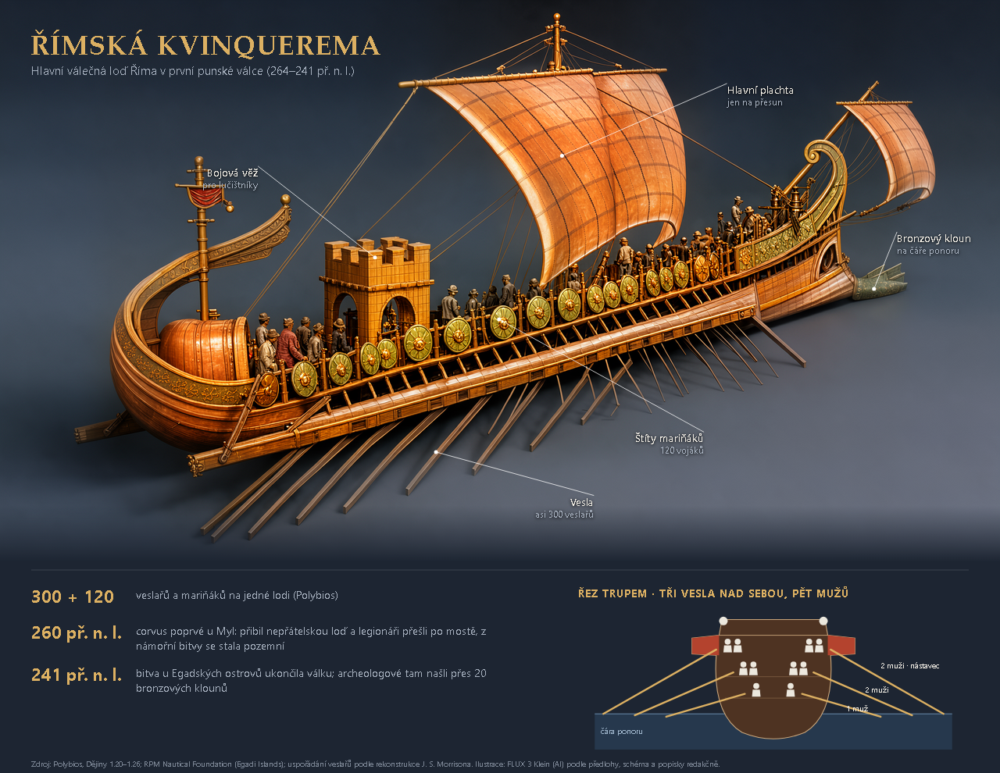

# G5 — infografiky: ověření (2026-10-23)

Náčrt schválil operátor 23. 10. ([1](img/g5-nacrt-1.png), [2](img/g5-nacrt-2.png)), vzor `models/flux3-klein/overlay_quinq3.html` („mnohem lepší“). Engine z větve `claude/grafik-g5-infografiky` na :8300 nad daty pracovní kopie (kvinquerema z G3), studio z větve na :5175, klikání ve vestavěném prohlížeči. Útrata **0 USD** („Navrhnout popisky“ přes Claude naživo neklikáno, útrata neschválena; ověřeno testem).

## Postup

1. Průvodce → kvinquerema → krok 5 „Popisky“ → **Otevřít v editoru infografiky**: dokument se založil nad vybraným natočeným pohledem, označení AI se doplnilo z provenience („Ilustrace: FLUX 3 Klein (AI) podle předlohy, schéma a popisky redakčně.“).
2. Pět popisků klikem do obrázku (bod na objektu), texty a drobné texty, tři fakta, schéma **ze šablony** (řez trupem ze schváleného vzoru, `schemas/rez-trupem-kvinquerema.svg`), zdroje.
3. Kontrola hlídala pravidla: „popisek 5 je delší než 30 znaků“ → zkrácení → „popisky krátké“; „před zveřejněním zkontroluje člověk“ zůstává, dokud se nevyplní jméno.
4. Popisky přetaženy skutečnou myší mimo objekt (polohy uložené automaticky).
5. Export **PNG** (1280×990), **SVG** (obrázek vložený, bez skriptů), **PDF** — vše v `library/infographics/<id>/exports/` s proveniencí (zdroje, popisky, fakta, označení AI, provenience podkladu, kdo kontroloval).

## Nálezy

- Z Průvodce se jako nadpis převzal celý anglický popis objektu; opraveno, bere se část před dvojtečkou (operátor nadpis stejně píše česky).
- Popisky se po kliknutí umístí nahoru a od středu obrázku; na široké lodi občas leží přes objekt, posunou se tažením.
- Termín „kloun“ pro beranidlo: operátor navrhl „zobec“ a napojení terminologické databáze (termdb). V termdb (`BIOLIB/termdb.db`) lodní termíny nejsou, viz STAV.
- Testy: `tests/test_infographics.py` 7 (čištění SVG, označení AI, dokument, export PNG/SVG/PDF s proveniencí, šablony schémat, placený návrh popisků).
