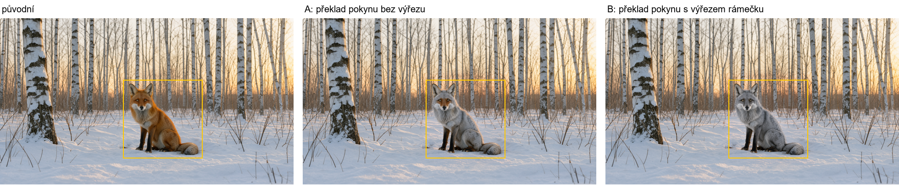

# Poznatky z PromptEnhancer: živé ověření (2026-10-23)

Placené běhy schválil operátor 23. 10. (Rozepsat zadání ~0,01 USD, A/B výřezu ~0,02 USD, měření klíčových bodů se soudcem Sonnet 5.5 ~1,11 USD). Engine z hlavního checkoutu, lokální FLUX 3 Klein.

## D: Rozepsat zadání

Zadání: „Římský přístav v Ostii kolem roku 100 n. l., tři obchodní lodě u mola, maják vzadu, na skladišti nápis „HORREA EPAGATHIANA““.

- **1. pokus: prázdný text, zaplaceno 0,01 USD.** Haiku 5.5 přemýšlí ve výchozím stavu a přemýšlení snědlo `max_tokens` 500; Engine prázdnou odpověď vrátil jako úspěch. Opraveno v cetej/GRAFIK#12 (u Haiku `thinking: disabled`, prázdná odpověď = chyba), LEARNINGS.
- **2. pokus: ~430 slov, utnuté** na 500 tokenech před závěrečnou větou o stylu. Opraveno v cetej/GRAFIK#13 (nejvýš 180 slov, limit 900).
- **3. pokus: v pořádku** (217 slov). Celek („A wide-angle view from a stone quay… looking out over the water“) → části s místem („In the background on the right… lighthouse“, „Behind the quay on the left… warehouse“, „In the middle distance, three merchant ships“, „in the foreground“) → světlo a soudržnost stínů („sunlight from the upper left, casting short shadows toward the lower right“) → poslední věta styl a typ obrázku („A photorealistic archaeological reconstruction… museum-style technical illustration“). Nápis zůstal beze změny: `"HORREA EPAGATHIANA"`. Přesný počet lodí 3, bez hodnotících slov.

Útrata za rozepsání: 3 × 0,01 USD (odhad Engine) = 0,03 USD, tedy o 0,02 USD víc, než bylo schváleno.

## B: překlad pokynu k úpravě s výřezem rámečku

Liška ve sněhu (1344×768, znovu vygenerovaná se stejným promptem a seedem jako v G2), rámeček kolem lišky, pokyn „přebarvi lišku na stříbrnou“, oba pokusy se stejným seedem obrázku.

- **A, bez výřezu** (dosavadní cesta): „The fox has silver-grey fur like an arctic fox.“
- **B, s výřezem:** „the red fox has silver-grey fur like a silver fox, with the orange coat replaced by a uniform silvery-grey coloration while the white chest, dark legs and bushy tail keep their shape“. Popis vychází z toho, co je ve výřezu (bílá hruď, tmavé nohy, huňatý ocas).

Výsledek: A nechalo oranžové tváře a okolí uší, B přebarvilo lišku celou a zachovalo bílou hruď a tmavé nohy. Mimo rámeček je rozdíl u obou **0,0** (paste-back). Jeden pár obrázků, není to statistika; směr odpovídá očekávání. Útrata 2 × 0,01 USD.

Ve studiu: strom verzí původní liška → v2 „změnit: přebarvi lišku na stříbrnou“ (B) a v3 (A).

## A: měření klíčových bodů

`python scripts/eval_keypoints.py --n 24 --judge-model claude-sonnet-5-5 --label raw-sonnet --confirm-cost`: 24 anglických promptů beze změny (seed vzorku 7), lokální FLUX 1024², seed obrázku 1, ~35 min. Úplná tabulka: [`2026-10-23-keypoints-raw-sonnet.md`](2026-10-23-keypoints-raw-sonnet.md), odpovědi soudce v `.json`.

- **Obrázky se všemi body: 5/24 (21 %).** Body celkem: **68/99 (69 %)**.
- Podle hlavní skupiny: atributy 24/31, děj 17/25, kompozitní (atmosféra, příběh) 13/16, vztahy 8/14, logo 2/4, gramatická konzistence 1/3, styl 0/2, znalost světa 0/1.
- Jednotlivé kategorie mají 1–5 bodů, jejich procenta nic neříkají. Vzorek je výchozí bod (baseline) pro srovnání, ne hodnocení FLUXu.
- Soudce Sonnet 5.5 je přísný a věcný: u gryfa poznal, že materiály jsou rozdělené vpředu a vzadu místo vlevo a vpravo, a „dokonalý odraz“ zamítl kvůli vlnkám; u mechanika poznal, že se opírá o jiný předmět než o robota. Žádný bod bez verdiktu.
- Slabá místa FLUXu podle vzorku: prostorové vztahy a dotyk („opírá se o…“), přesně popsaný styl, odrazy.

Útrata podle odhadu skriptu 1,11 USD (skutečné tokeny se nezaznamenávají; zapsáno v `library/costs.jsonl` jako odhad).

Další krok, pokud bude zájem: stejný vzorek s `--expand --label expand-sonnet` (rozepsání před generováním) ukáže, jestli D pomáhá; rozdíl pod ~10 p. b. nečíst.
