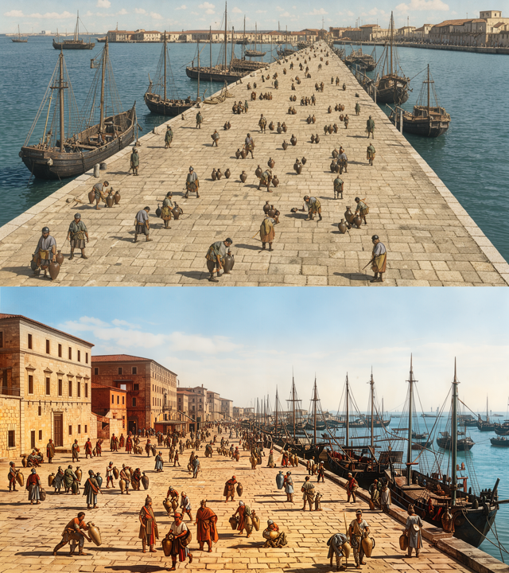
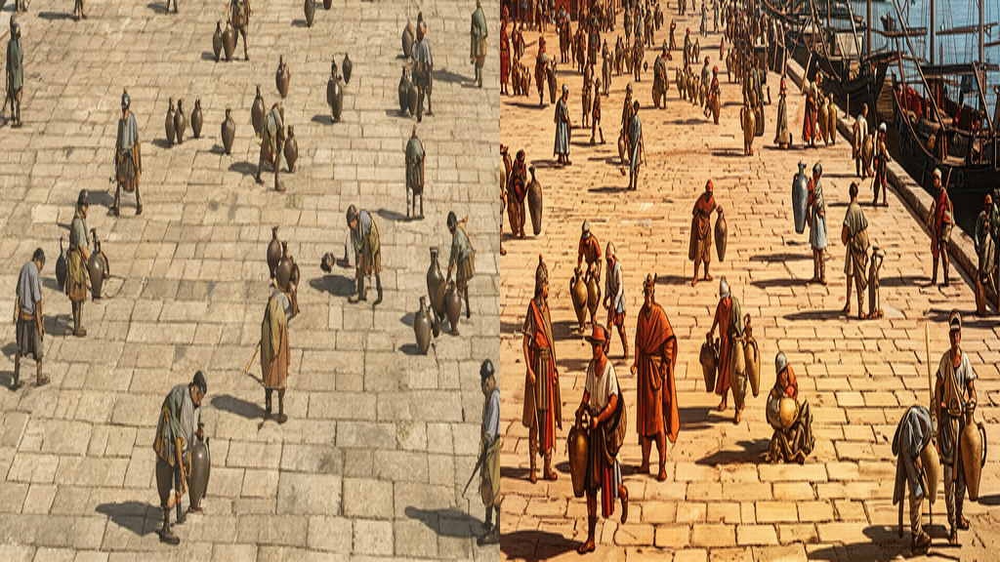

# Supersample: vykreslit výš a zmenšit (2026-10-23)

`ImageRequest.supersample` (1–4, jen `flux-local`): FLUX vykreslí `size × supersample`, zastropováno na 1920×1088 px při zachování poměru stran a zaokrouhleno dolů na násobky 16; Engine výsledek zmenší Lanczosem na `size`. V provenienci `params.render_size`. Placené backendy `supersample` odmítnou (400). Klient: `generate(..., supersample=2)`, CLI `--supersample 2`.

## Živé A/B na RTX 4060 (0 USD)

Prompt: římský přístav, desítky drobných dělníků s amforami; 1024×576, seed 11.

| | render | čas |
|---|---|---|
| bez supersample | 1024×576 | 26,3 s |
| `supersample=1.875` | 1920×1072 → 1024×576 | 84,6 s |

Výřez středu (vlevo bez, vpravo se supersample):

Drobné postavy se supersample mají čitelné tváře, oděvy, amfory v rukou a stíny; bez něj jsou to rozmazané siluety. Kompozice se liší: jiné rozlišení latentu = jiný šum i při stejném seedu, takže supersample není „zaostření“ hotového obrázku, ale nový render. Cena ~3,2× času.
