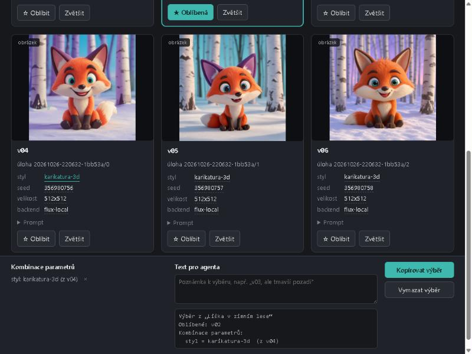

# Stránka variant: N obrázků k výběru místo iterace (2026-10-26)

Nápad z článku „How I work with Agents“ (říjen 2026): místo kol „zkus tohle… ne, tamto“ vygenerovat dávku a vybírat na jedné stránce. Pomocník je ve STOPA (`scripts/manual/variants_page.py`, cetej/STOPA#2655); GRAFIK je jeho první uživatel.

## Jak se to volá

```
python clients/grafik_client.py variants "a red fox sitting in a snowy birch forest at dawn" ^
    --count 6 --style akvarel-prirodovedny --style karikatura-3d --size 512x512 --out scratch/varianty-demo
```

Z Pythonu `grafik_client.variants(prompt, count=…, styles=[…], out_dir=…)`. Varianty se rozdělí mezi styly, každý styl na úlohy po nejvýš 4 obrázcích (strop `n` v Engine). Do složky jdou PNG, `manifest.json` a `varianty.html`, stránka se otevře v prohlížeči (`--no-open` ne).

Placená dávka (`--backend nb-pro` nebo `fal:…`, i česká zadání s placeným překladem): klient nejdřív sečte odhad `/api/v2/estimate` za CELOU dávku; bez `--confirm-cost` skončí s touto částkou a nic se nespustí.

## Ověřeno naostro

- Lokální FLUX, 6 variant 512×512 ve dvou stylech, 0 USD: 2 úlohy (`20261026-220632-d7f022`, `…-1bb53a`), 6 PNG 515–690 kB, manifest s parametry styl / seed / velikost / backend.
- Stránka v prohlížeči: všech 6 obrázků načtených (naturalWidth 512), klik „Oblíbit“ u v02 a na hodnotu „karikatura-3d“ u v04 dá v panelu text pro agenta:

```
Výběr z „Liška v zimním lese“
Oblíbené: v02
Kombinace parametrů:
  styl = karikatura-3d  (z v04)
```



## Testy

`tests/test_engine_v2.py`: rozdělení dávky (`_plan`), konec-konec přes falešný sd-server (manifest, 6 PNG, stránka, otevření prohlížeče) a placená dávka 8 obrázků přes `nb-pro` (odhad = 8 × jeden obrázek, žádná úloha ve frontě). `variants_page.py` je jen stdlib jako klient.

## Studio: Dávka na výběr (2026-10-26, druhá část)

- Engine `POST /api/v2/variants` `{request, count 2–40, styles[], title}`: stejné rozdělení jako klient (styl × úlohy po 4), odhad za celou dávku (402 bez `confirm_cost`), jen `flux-local`. Záznam `library/variants/<id>/batch.json`.
- `GET /api/v2/variants/<id>/varianty.html`: dokud dávka běží, čekací stránka s průběhem a obnovou po 3 s; pak zkopíruje PNG, napíše `manifest.json` a stránku výběru (relativní obrázky jdou přes `/api/v2/variants/<id>/<soubor>`).
- Studio `studio/src/Batch.tsx`: panel pod Vygenerovat, řádek dávky ve frontě (poslední 3 dávky v `localStorage`, přežijí obnovení stránky).
- Ověřeno v prohlížeči proti Engine z worktree s falešným sd-serverem z testů (bez GPU): 8 variant ve 3 stylech (bez stylu, akvarel, karikatura 3D) → 3 úlohy, stránka se 8 obrázky 1344×768 (všechny načtené), řádek ve frontě po obnovení stránky zůstal.
- Testy: `tests/test_engine_v2.py::test_studio_variants_*` (dávka a stránka, čekací stránka, jen lokálně a cena za celou dávku); celá sada 96 passed.
