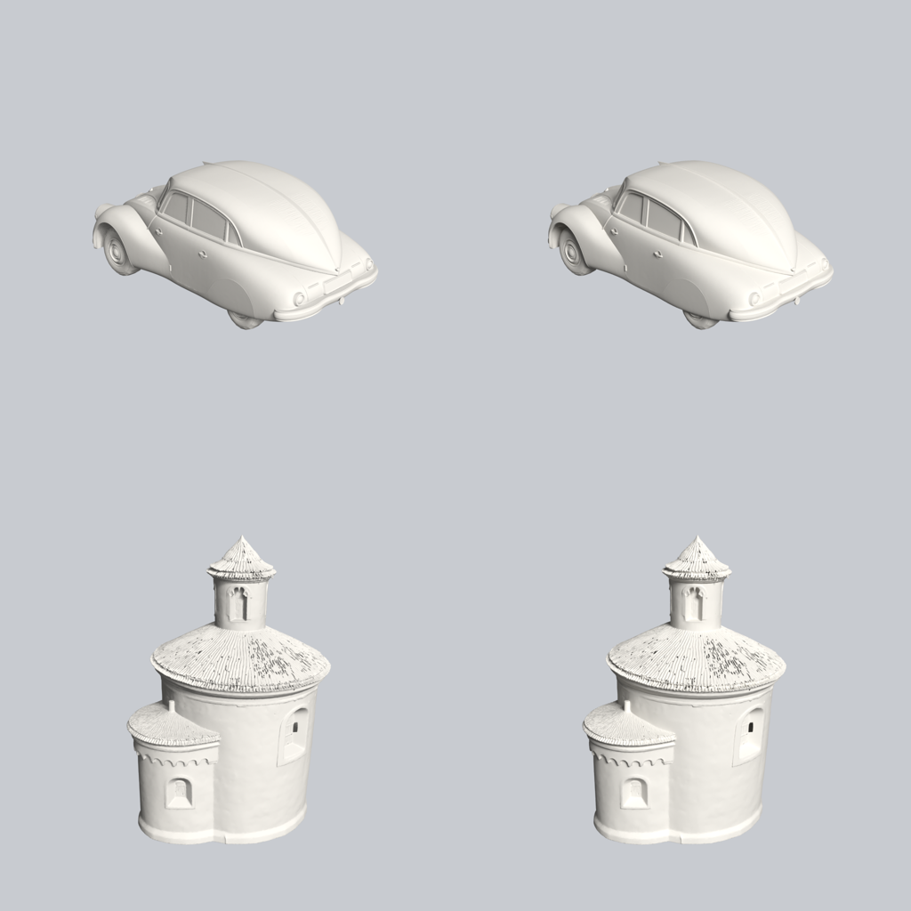

# Spike 2026-10-27 (3D v1, T1): bílé pohledy v Blenderu na grafice, nebo na procesoru?

Otázka Q1 z návrhu `docs/plans/2026-10-27-3d-v1.md`: Blender (EEVEE) vedle načteného FLUX shodil úlohu FLUX (7,2 z 8 GB, LEARNINGS 2026-10-27). Varianta (a) zastaví vlastní sd-server před renderem, (b) renderuje na procesoru (Cycles CPU). Návrh byl (a) s tím, že rozhodnou čísla.

## Postup

- Skript Engine `engine/blender/render_views.py`: 8 pohledů po 45°, kamera 20° nad, 1024×1024, jeden matný šedý materiál, průhledné pozadí. EEVEE (výchozí), nebo `--cpu` = Cycles na CPU, 32 vzorků + denoise.
- Blender 5.2.3 LTS, RTX 4060 8 GB, sd-server zastavený (FLUX nenačtený), zámek GPU držený po celou dobu měření.
- VRAM: `nvidia-smi memory.used` každých 0,3 s, špička proti stavu před startem. Čas včetně startu Blenderu a načtení GLB.
- Měřicí skript: scratchpad session (`measure_t1.py`), výsledky níže.

## Výsledky

| Model | Vrcholy | EEVEE (GPU) | Cycles CPU |
|---|---|---|---|
| Tatra 87, Hunyuan3D v3 (8,6 MB) | 250 tis. | **27,9 s**, +1 245 MiB VRAM | **37,7 s**, +0 MiB |
| Rotunda sv. Martina, TRELLIS 2 (19,6 MB) | 417 tis. | **15,8 s**, +1 247 MiB VRAM | **37,8 s**, +0 MiB |

Kvalita bílých pohledů je na oko stejná (vlevo EEVEE, vpravo Cycles CPU):

## Rozhodnutí: (b) Cycles na CPU

- Render na procesoru je o 10–22 s pomalejší, ale FLUX zůstane načtený. Varianta (a) by po každém renderu zaplatila studený start FLUX při další obrazové úloze (40–120 s, G1 měření) a sahala by na grafiku, kterou mohou držet jiné programy (dabing, Whisper, Illustrator).
- 0 MiB VRAM znamená, že se render s FLUX nepřetlačí ani v nejhorším případě.
- Blender přesto běží pod zámkem GPU (sc-4): jedna fronta, žádný souběh s jinými programy, které zámek respektují. Volba jde přepnout `GRAFIK_RENDER_CPU=0`; pak Engine před renderem zastaví vlastní sd-server podle PID (varianta a).
- Časový limit Blenderu 3 min (sc-8) má proti 38 s rezervu ~4×.
