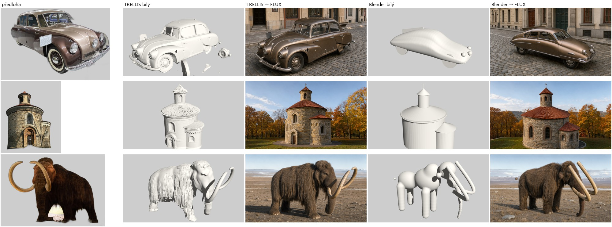
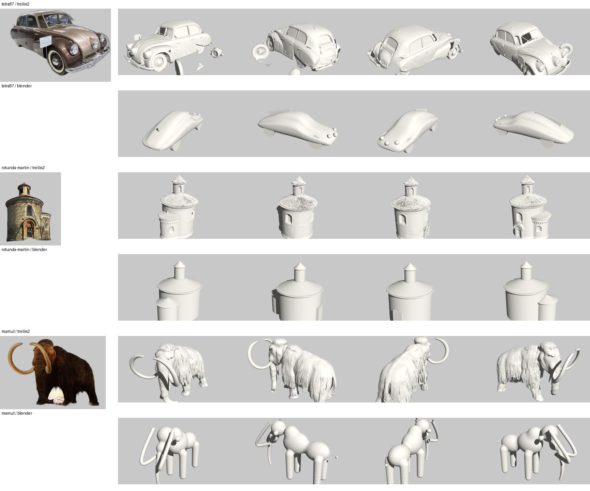
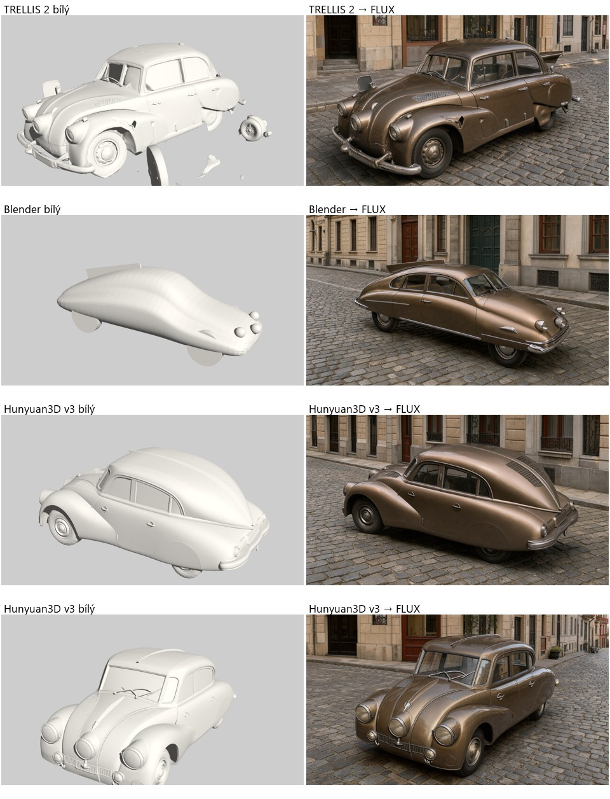

# Spike 2026-10-27: TRELLIS 2 nebo Blender z rozměrů? Měření na třech objektech

Operátor 27. 10.: „Trellis i Blender – nemáme vyhodnocené, co je lepší.“ Měření schválil do 1 USD. Navazuje na spike [`2026-10-23-3d-trellis-blender.md`](2026-10-23-3d-trellis-blender.md) (jen loď) a na concepts brief STOPA `outputs/2026-10-27-grafik-3d-concepts-brief.md`.

## Postup

Tři objekty jiného typu než loď: vozidlo (Tatra 87), budova (rotunda sv. Martina na Vyšehradě) a zvíře (mamut srstnatý). Každý prošel oběma cestami a na konci stejným krokem:

| Krok | TRELLIS | Blender |
|---|---|---|
| Vstup | foto z Wikimedia Commons, ořez a výřez pozadí přes rembg (u2net) | rozměry se zdrojem v `DIM` (Wikipedia), zbytek odhad |
| Model | fal `fal-ai/trellis-2`, 1024p, seed 7 | `scripts/3d/lod_tatra87.py`, `lod_rotunda_martin.py`, `lod_mamut.py` |
| Bílý render | `render_glb.py --clay`, 4 pohledy (30/120/210/300°) | totéž |
| Obrázek | lokální FLUX, bílý pohled jako `role: geometry`, stejný prompt, seed 42, 1280×720, `translate: off` | totéž |

Předlohy: *1947 Tatra Type 87 Saloon (29816604587).jpg* (CC BY 2.0), *Praha, rotunda svatého Martina (2012).JPG* (CC BY-SA 3.0), *Woolly mammoth model Royal BC Museum in Victoria.jpg* (CC BY 2.0). Modely a provenience: `library/3d/<objekt>-trellis2/` a `library/3d/<objekt>-blender/`.

## Výsledky

| | Tatra 87 | Rotunda | Mamut |
|---|---|---|---|
| **TRELLIS:** čas, cena | 139 s, 0,30 USD | 102 s, 0,30 USD | 89 s, 0,30 USD |
| TRELLIS: model | detaily (okna, blatníky, kola), ale **plovoucí úlomky** z muzejní cedulky a krátká záď | věrný fotce: okna, římsa, lucerna, apsida, portál | věrný: srst, kly, chobot; poznatelný ze všech stran |
| TRELLIS → FLUX | **obecný sedan ze 40. let**, ne Tatra (bez ploutve, krátká záď) | **nejlepší**: odpovídá skutečné rotundě | dobrý mamut |
| **Blender:** iterace, cena | 1 iterace, 0 USD | 1 iterace, 0 USD | **2 iterace** (napoprvé se metaballs nespojily), 0 USD |
| Blender: model | hladké „mýdlo“, ale rozměry sedí (4,78 × 1,66 × 1,57 m proti 4,74 × 1,67 × 1,50) | jednoduché tvary, výška a střecha jen odhad | nafukovací hračka |
| Blender → FLUX | **nejlepší**: dlouhá aerodynamická záď, hřbetní ploutev, tři světla, tedy Tatra 87 | uvěřitelná rotunda, ale nižší a širší než skutečná (výška je odhad) | dobrý mamut, srovnatelný s TRELLIS |
| Vítěz | **Blender** | **TRELLIS** | nerozhodně |

Poměr šířka/délka podle orientovaného bboxu u Tatry: skutečnost 0,352, Blender 0,348, TRELLIS 0,83. Číslo TRELLIS zkreslují úlomky, ale i vizuálně je záď krátká: TRELLIS převzal zkrácení perspektivy z fotky ve tříčtvrtečním pohledu.

**Hlavní zjištění:** FLUX dokreslí detail a materiál sám. Bílý model musí nést **poměry a obrys**, ne detail. Proto hrubý Blender model se správnými rozměry porazil detailní TRELLIS model se špatnými poměry (Tatra). Tam, kde poměry nemáme ze zdrojů a fotka je dobrá, je lepší TRELLIS (rotunda: výšku jsme v Blenderu jen odhadli).

## Paměť grafiky (otázka z brainstormu)

- Bílý render samotný: 4 pohledy za 11–13 s, špička **~1,2 GB VRAM** (EEVEE), u Blenderu i u TRELLIS modelu (338–502 tis. vrcholů).
- **Render souběžně s načteným FLUX: selhalo.** Špička 7,2 GB z 8 GB a úloha FLUX dvakrát spadla (`flux3 segment … failed during workspace capacity check`, Engine sd-server restartoval a zkusil znovu, Blender paměť ale pořád držel). Render se navíc zpomalil na 38,6 s za 2 pohledy.
- Z toho plyne: Blender **musí běžet pod zámkem GPU** (`engine/jobs.py:245` dnes bere zámek jen pro `flux-local`), nebo na CPU. Souběh není bezpečný.

## Návrh pravidla „kdy co“ (rozhoduje operátor)

1. **Známé rozměry a rozhodují poměry** (vozidla, lodě, stroje, technika): **Blender z rozměrů**. Stačí hrubé tvary, detail dodá FLUX. 0 USD, skript píše Claude, 1–2 iterace.
2. **Dobrá fotka, poměry ze zdrojů chybí, rozhoduje ornament a silueta** (budovy, sochy, předměty z muzea): **TRELLIS** za 0,30 USD. Vyžaduje čistý výřez bez cedulek a pak odstranění plovoucích úlomků.
3. **Zvířata a organické tvary:** pro FLUX obrázek stačí obě cesty. TRELLIS je lepší, když má být vidět model sám (víc pohledů, 3D náhled), Blender je zdarma.

## Vady, které se ukázaly

- Výřez rembg nechal muzejní cedulku u Tatry a pozadí mezi nohama mamuta. TRELLIS z cedulky udělal plovoucí úlomky. Před TRELLIS je potřeba výřez zkontrolovat, po něm nechat jen největší souvislou část modelu.
- `render_glb.py` s výchozí vzdáleností kamery (1,9) ořízne vysoké objekty. Přidal jsem volbu `--dist` (rotunda: 2,7).
- Metaballs v Blenderu potřebují nízký `threshold` (0,25), jinak se kuličky nespojí.

## Doplněk: Hunyuan3D v3 se třemi pohledy na Tatře 87

Na pokyn operátora (do 0,50 USD) po průzkumu `docs/capabilities/3d-moznosti-2026-10-27.md`. Vstup: tři fotky z Commons (zepředu a z boku z NTM Praha, zezadu z Lane Motor Museum), výřez rembg, z bočního pohledu ručně vymazané cizí auto. fal `fal-ai/hunyuan3d-v3/image-to-3d`, `generate_type: Geometry`, `left_image_url` + `back_image_url`. Za 80 s, 0,375 USD. Skript `scripts/3d/hunyuan_run_tatra.py`, model `library/3d/tatra87-hunyuan3d/`.

| | šířka/délka | výška/délka | úlomky | FLUX |
|---|---|---|---|---|
| skutečnost (4,74 × 1,67 × 1,50 m) | 0,352 | 0,316 | | |
| TRELLIS 2 (1 fotka) | 0,83 (úlomky) | 0,40 | ano | obecný sedan |
| Blender z rozměrů | 0,348 | 0,328 | ne | Tatra 87, správně dlouhá |
| **Hunyuan3D v3 (3 pohledy)** | **0,530** | **0,437** | **ne** | **Tatra 87 poznatelná**: zezadu žaluzie motoru, hřbet a zaoblená záď, zepředu tři světla; vůz ale vychází kratší a vyšší |

- Víc pohledů odstranilo úlomky a přineslo detaily, které TRELLIS z jedné fotky neměl (zadní partie). Poměry se zlepšily jen částečně: vůz je asi o třetinu kratší, než má být.
- Pravděpodobná příčina: fotky jsou z různých vozů, ani jedna není čistý ortogonální pohled (boční je mírně šikmo, zadní je ze tří čtvrtin). [neověřeno, chtělo by to pokus s čistými pohledy]
- Hunyuan3D v3 je pro tvarovou předlohu lepší než TRELLIS 2, když jsou k dispozici fotky z víc stran. Na přesné poměry dál vede Blender z rozměrů. Kombinace (Hunyuan model natáhnout v Blenderu na rozměry ze zdroje) je nezkoušená.

## Útrata

3 × TRELLIS 2 1024p = **0,90 USD** (`library/costs.jsonl`, caller `spike-3d`). FLUX 6 obrázků + 2 neúspěšné pokusy: 0 USD. Doplněk Hunyuan3D v3: 0,375 USD, FLUX 2 obrázky 0 USD. Celkem 1,275 USD.
