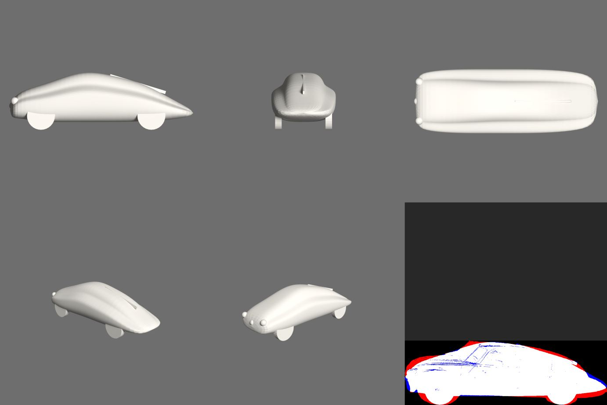

# Spike 2026-10-31: smyčka render + měření pro `lod_*.py` (GRAFIK#71)

Závěr: kontrola funguje na hotových modelech a tři kola zlepšila Tatru z rozměrů proti siluetě z IoU 0,795 na 0,892. Postup: [`../3d-lod-postup.md`](../3d-lod-postup.md). Vše 0 USD, FLUX se nespouštěl, Blender pod zámkem těžké práce.

## Kontrola na modelech z knihovny

`engine/blender/inspect_model.py` přes `scripts/3d/lod_check.py`:

| Model | Co kontrola hlásí | Odpovídá skutečnosti? |
|---|---|---|
| `mamut-blender` (`--tel 5`) | 3 díly bez kontaktu: oba kly (mezera 7,6 cm), ocas (32 cm); průřezy 5 těl | ano, ve spiku z 27. 10. to zmíněné není; kulička ocasu je na bílém snímku vidět a FLUX z ní udělal kamínek ve vzduchu |
| `slon-hunyuan3d` (`--tel 5`) | průřez ve výšce 25 %: 6 těl, poslední na zádi; v 5 % jen 3 na zemi | ano, pátá končetina ze zádi, kterou agent 27. 10. přehlédl a našel operátor. Model je jediná souvislá část, počet dílů ji neukáže, jen průřez |
| `tatra87-blender` (`lod_tatra87.py`) | šířka/délka 0,348 proti 0,352, výška/délka 0,328 proti 0,316; 9 dílů, žádný bez kontaktu; v 5 % výšky 4 kola | ano, stejná čísla jako spike 27. 10. |
| `doryforos-hunyuan3d` | 2 díly, malý úlomek s mezerou 0,025 jednotky modelu | úlomek jsem na velkém renderu nehledal |

Průřezy dávají smysl jen s `--tel` podle objektu. Nejsou to nohy, jen počet oddělených těl: Tatra ve 15 % výšky 3, protože dvě kola splývají se spodkem vozu.

## Bez smyčky a se smyčkou: Tatra 87

Silueta: boční fotka z knihovny narovnaná podle kol, výška srovnaná na rozměr ze zdroje ([skript](2026-10-31-tatra-silueta.py)). Je přibližná, takže platí srovnání kol mezi sebou, ne metry.

| | IoU se siluetou | odchylka obrysu začátek / střed / záď (% délky) | šířka/délka | výška/délka | co jsem opravil pro další kolo |
|---|---|---|---|---|---|
| Skutečnost | | | 0,352 | 0,316 | |
| **Bez smyčky** (`lod_tatra87.py`, 27. 10.) | 0,795 | 5,82 / 1,82 / 3,34 | 0,348 | 0,328 | ploutev jako prkno nad střechou zvyšuje vůz o 4,7 %; příď moc nízká, záď vysoko |
| Kolo 2 | 0,885 | 1,68 / 0,68 / 1,28 | 0,348 | 0,317 | horní hrana průřezů ze siluety; ploutev dál trčí, světla zmizela v přídi |
| **Kolo 3** (`lod_tatra87_v2.py`) | **0,892** | **1,36 / 0,40 / 1,12** | 0,350 | 0,311 | konec: `problemy` prázdné |

Tvar zůstává „mýdlo“: kontrola opravila poměry a obrys, ne plochy a detail. Silueta navíc pochází z jedné šikmé fotky. **Výsledek bílého modelu ve FLUX jsem neověřoval** (FLUX se v tomto běhu spouštět nemá): zda se lepší obrys pozná i na obrázku, ukáže až [srovnání variant](2026-10-31-tatra-zad.md).

Bez `--ref` by smyčka skončila hned v 1. kole, poměry procházejí i původnímu modelu. Proto má obrys vlastní toleranci.

## Na co dát pozor

- **Automatická volba zrcadla podle překryvu lhala.** První verze si vybírala směr modelu podle lepšího IoU a u Tatry přiřadila příď k zádi siluety; čísla vypadala dobře (0,821). Našlo se to jen pohledem na překryv. Teď směr říká autor (`--zrcadlit`).
- Generátory ukládají 3 vrcholy na plochu. Bez svaření podle polohy by každý trojúhelník byl samostatný díl a každá hrana otevřená (test `tests/test_lod_check.py`).
- Průřez kreslí obrysy, část uvnitř jiné části by se jinak počítala jako další tělo. Proto se před počítáním vyplní.
- U `mamut-trellis2` 147 dílů: porovnává se jen 40 největších, zbytek hlásí `fragmentu_navic`.
- Smyčkou prošla jen Tatra; kly mamuta zůstávají v `lod_mamut.py` neopravené.
