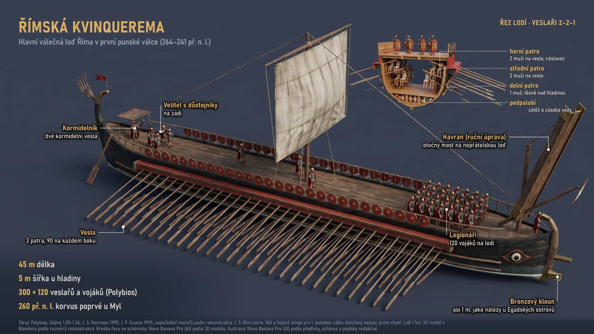

# Převzetí ruční úpravy z VectorCraftu do exportů (2026-10-31)

Kopie skutečné infografiky „Římská kvinquerema“ (`20261023-133046-2ea6`) v dočasných datech (`GRAFIK_DATA_DIR`), VectorCraft 0.13.1 bez okna. Do knihovny operátora se nic nezapsalo. 0 USD.

Úprava: popisek „Korvus“ přepsaný na „Havran (ruční úprava)“, text „zátěž a zásoba vody“ posunutý o 60 px, uloženo přes kopii (`.svg`) a jako `.vectorcraft`.

| Otázka | Výsledek |
|---|---|
| Doba převzetí přes HTTP (PNG + PDF + SVG) | 3,9 s a 4,3 s na soubor 5,5 a 7,3 MB |
| Rozměry | PNG 1920×1080, PDF `MediaBox 1920×1080`, SVG 8,2 MB bez `<text>` (křivky) |
| Otevřené okno na stejném souboru | Převzetí proběhlo, okno dál běželo a zavřelo se normálně |
| Zdroj a složka `vectorcraft/` | sha256 všech souborů beze změny, žádný nový soubor |
| Starší exporty (13 PNG z 23. 10.) | sha256 beze změny |
| Oznámení AI přepsané | Odmítnuto, žádný nový soubor v `exports/` |
| Patička skrytá (`object.hide`) | Odmítnuto, žádný nový soubor v `exports/` |
| Patička posunutá o 500 px mimo plátno | První verze prošla, PNG větu nemělo. Kontrola teď čte z `inspect_document` jen viditelný text uvnitř plátna: odmítnuto |
| PNG proti SVG v křivkách vykreslenému v Chromiu | Rozdíl nad 32 úrovní u 1 905 z 2 073 600 pixelů (hrany), bez posunu textu |
| Provenience | zdroj, sha256, čas uložení, verze VectorCraftu, 29 textů přečtených ze souboru včetně „Havran“; podklad a jeho provenience z dokumentu |
| Studio | Seznam úprav se obnoví po návratu do okna, chyba česky, jen kliknuté tlačítko ukáže „Převádím…“, náhled se otevře v plné velikosti |

## Co kontrola nepozná

Text schovaný barvou, průhledností nebo jiným objektem. Kontrola hlídá přítomnost věty na plátně, ne její čitelnost.

## Neměřeno

Čekání na zámek proti běžícímu FLUX se skutečnou úlohou. Odmítnutí po 120 s pokrývá test s náhradou `HeavyBusy`.

Test se skutečným VectorCraftem: `GRAFIK_VECTORCRAFT_TESTS=1 pytest tests/test_infographics.py -k real_vectorcraft`.
