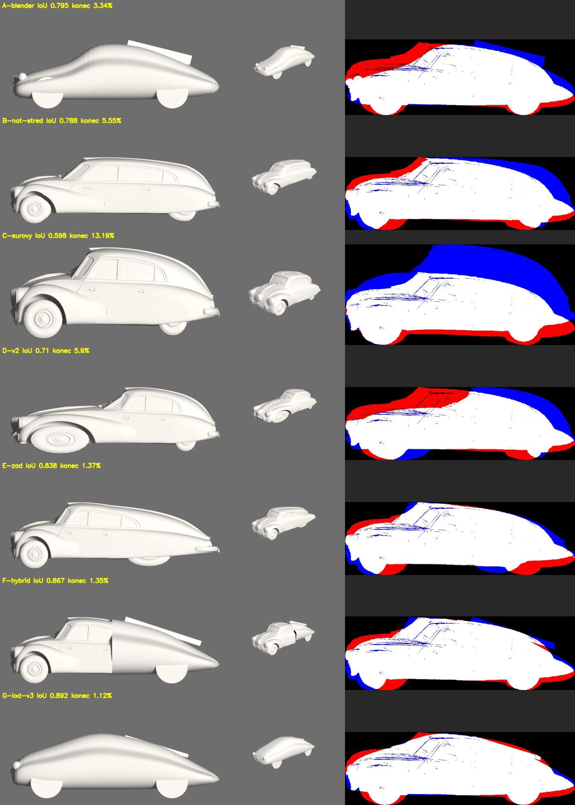
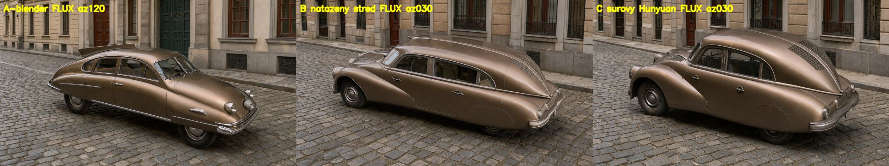

# Spike 2026-10-31: záď Tatry 87, AI model natažený na rozměry a hybrid (GRAFIK#72)

Stav: **geometrie změřená, FLUX u nových variant nespuštěný** (v tomto běhu zakázaný kvůli RAM, stál by 0 USD). Pořadí metod do `docs/DECISIONS.md` jde až po verdiktu operátora. Žádné placené volání, hotové modely beze změny, nové leží v `library/spikes/2026-10-31-tatra-zad/`.

## Tabulka variant

Silueta: boční fotka narovnaná podle kol, výška srovnaná na zdroj ([skript](2026-10-31-tatra-silueta.py), [náhled](img/2026-10-31-tatra/silueta.jpg)). Je přibližná, takže platí pořadí, ne procenta jako přesná míra. Záď = poslední třetina délky.

| Varianta | šířka/délka (0,352) | výška/délka (0,316) | IoU | **obrys zádě** | vidět na bílém modelu | FLUX |
|---|---|---|---|---|---|---|
| **G** Blender z rozměrů, 3 kola kontroly (`lod_tatra87_v2.py`) | 0,350 | 0,311 | **0,892** | **1,12 %** | hladké mýdlo bez detailu | nespuštěný |
| **F** hybrid: předek z AI, záď z G po 2. kole, řez 2,3 m (`hybrid_zad.py`) | 0,353 | 0,320 | 0,867 | 1,35 % | detail vpředu, **viditelný schod v řezu** | nespuštěný |
| **E** Hunyuan, natažená jen záď (`stretch.py end-max`) | 0,352 | 0,316 | 0,838 | 1,37 % | dlouhá zaoblená záď, **zadní kolo oválné a placaté** | nespuštěný |
| A Blender z rozměrů, 27. 10. (`lod_tatra87.py`) | 0,348 | 0,328 | 0,795 | 3,34 % | ploutev jako prkno nad střechou | hotový: Tatra, zepředu |
| B Hunyuan, natažený střed (`stretch_glb.py`) | 0,352 | 0,316 | 0,788 | 5,55 % | limuzína s dlouhou kabinou | hotový: limuzína |
| D `tatra-87` v2 (`end-min`) | 0,352 | 0,316 | 0,710 | 5,90 % | **natažená příď, přední kolo ovál** | není |
| C surový Hunyuan | 0,529 | 0,436 | 0,598 | 13,19 % | krátký a vysoký | hotový: kratší a vyšší |

## Co z toho plyne

- **Záď se musí opravit v modelu.** FLUX bílý model sleduje téměř přesně ([měření #86](2026-10-31-tvar-hrany-tok.md)). Limuzína B vznikla natažením středu.
- **Natažení správného konce samo stačí na obrys zádě** (B 5,55 % → E 1,37 %), ale kola v natažené části se deformují. `stretch.py` drží tuhé oba konce jen při `middle`.
- **Hybrid F drží obrys, ale má schod** v místě řezu: oba povrchy jsou jen uřízlé a spojené. Zda ho FLUX překreslí, nevím.
- Varianta „Blender model jako tvarová předloha, AI model jako druhá předloha detailu“ bez FLUX nejde změřit, zůstává v plánu.

## Nález mimo zadání

`library/3d/tatra-87/v2`, který čeká na operátorovu kontrolu, je natažený na **špatném konci**: `end-min` u tohoto modelu protáhl příď a přední kolo je ovál (řádek D). Příď má model na −Y, záď tedy odpovídá `end-max`. Model jsem nepřepsal. Poměry přitom sedí přesně, ukáže to až obrys.

## Doporučení (čeká na verdikt)

1. Vozidla a technika se známými rozměry: **G, Blender z rozměrů s kontrolou `lod_check.py`.** Nejlepší obrys, 0 USD, detail dodá FLUX.
2. Když je potřeba detail z AI modelu: natáhnout **záď, ne střed**, a kola opravit nebo překrýt. F až po ověření, že schod ve FLUX zmizí.
3. Před zápisem do `DECISIONS.md` pustit E, F a G lokálním FLUX stejným promptem (seed 42, stejné pohledy jako 27. 10., 0 USD).
