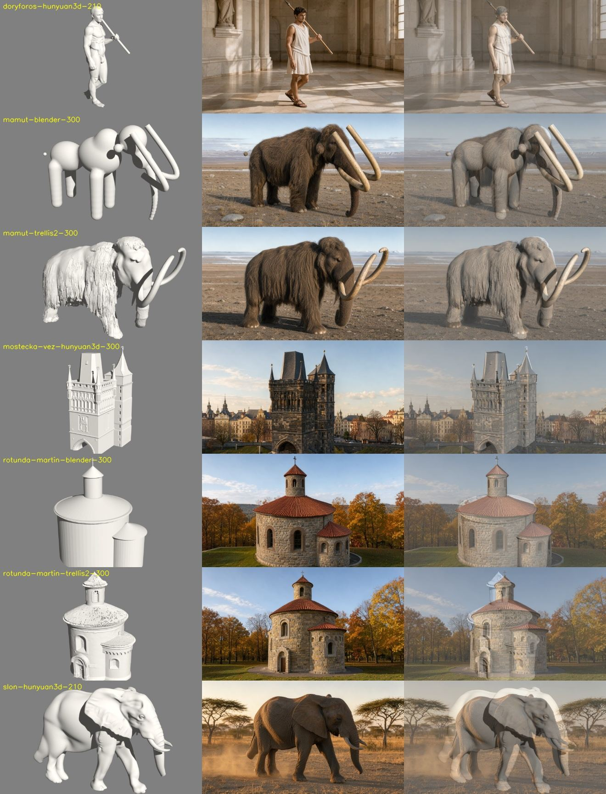
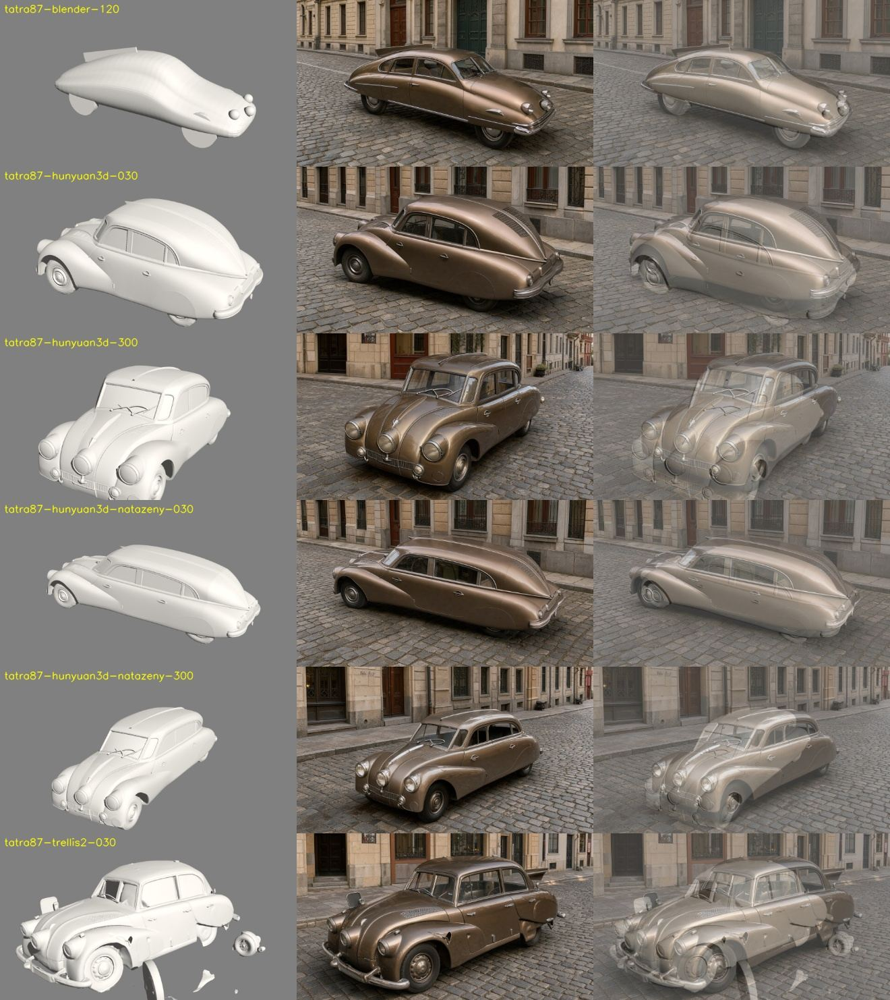
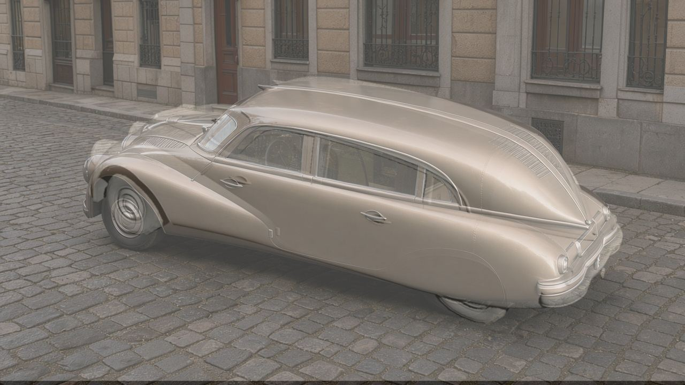

# Spike 2026-10-31: pozná mapa hran a optický tok, že FLUX neudržel tvar? (GRAFIK#86)

Závěr: **neodliší, nic se nestaví.** Pevný práh buď pustí špatnou dvojici, nebo hlásí 40 % dobrých. Hlavní zjištění je jinde: vada zádě Tatry vzniká v modelu, FLUX ho věrně sleduje, takže porovnání bílý snímek / FLUX ji z principu nemůže najít.

## Postup

13 hotových dvojic bílý snímek / výsledek lokálního FLUX ze spiku [2026-10-27](2026-10-27-3d-trellis-vs-blender.md), 0 USD, jen CPU, FLUX se nespouštěl. Označení špatných převzato z toho spiku před měřením: Tatra natažená 030 (záď jako limuzína), Tatra TRELLIS 030 (obecný sedan), slon 210 (zadní noha). Skript: [`2026-10-31-tvar-hrany-tok.py`](2026-10-31-tvar-hrany-tok.py), mapa hran podle zadání (Sobel z rozmazaného jasu, `log1p`), `cv2.DISOpticalFlow` bez dalšího vyhlazení, měřeno na delší straně 512 px.

Kontroly se známou odpovědí: tentýž výsledek FLUX proti **jinému pohledu** téhož modelu (13 případů) a proti **jinému modelu ze stejného úhlu** (8 případů: rotunda, mamut, Tatra surová × natažená).

Sloupce: bílý snímek, FLUX, překryv.

## Výsledky

| metrika (lepší = nižší, `ncc` vyšší) | špatné dvojice | dobré dvojice | AUC | správný snímek lepší než jiný pohled / jiný model |
|---|---|---|---|---|
| **tok, medián** | 20,0–24,0 | 4,7–24,0 | **0,87** | **12/13 / 7/8** |
| tok, p90 | 35,0–37,6 | 10,2–61,1 | 0,67 | 9/13 / 6/8 |
| shoda hran po zarovnání (`ncc`) | 0,24–0,30 | 0,16–0,36 | 0,38 | 11/13 / 6/8 |
| tok po zarovnání, medián | 5,8–18,2 | 4,0–60,5 | 0,40 | 10/13 / 7/8 |
| tok po zarovnání, p90 | 21,7–43,9 | 9,6–83,8 | 0,57 | 6/13 / 6/8 |

Práhy na mediánu toku (jediná použitelná metrika):

| práh | špatné zachyceno | falešný poplach na dobrých | jiný pohled | jiný model |
|---|---|---|---|---|
| 15 | 3/3 | **4/10** (i Tatra z Blenderu, nejlepší výsledek měření) | 13/13 | 8/8 |
| 18 | 3/3 | 3/10 | 9/13 | 6/8 |
| 20 | 2/3 | 2/10 | 7/13 | 3/8 |

- AUC 0,87 je z velké části rozdíl mezi objekty: všechny špatné dvojice leží v horní části jako auta na dlažbě. Jen mezi Tatrami je AUC 0,75 (6 dvojic).
- Práh je nastavený na stejných datech, jen 3 špatné dvojice a mezi 13,5 (poslední dobrá pod prahem) a 14,9 (nejnižší kontrola) je úzká mezera. Na nová data bych ho nepřenášel.
- Zarovnání (měřítko a posun podle shody hran) měření nepomohlo, spíš ublížilo: pozadí FLUX (dlažba, fasády) má víc hran než objekt a zarovnání na něm uvízne. Tatra natažená 300 dostala posun o 169 px a tok 60.
- Tok tedy měří hlavně posun objektu a texturu pozadí. Přesun celého objektu se započítá stejně jako změna tvaru (Tatra z Blenderu: tvar drží, auto je jen posunuté).

## Vada zádě je v modelu, ne ve FLUX

Natažená Tatra 030 po ručním zarovnání (měřítko 1,08, posun z měření): FLUX sedí na bílý snímek téměř přesně včetně oken, klik a zádě. „Limuzínu“ vyrobilo natažení středu vozu (`stretch_glb.py`), FLUX ji jen věrně namaloval. Tok přitom i tady hlásí 18 px.

Totéž platí pro TRELLIS Tatru: „obecný sedan“ je už v bílém modelu. Kontrola mezi bílým snímkem a FLUX tyhle vady nemůže najít. Patří před FLUX, tedy model proti rozměrům a siluetě skutečného objektu: `scripts/3d/lod_check.py` (GRAFIK#71, [srovnání variant](2026-10-31-tatra-zad.md)).

## Proč se nestaví ani jednostranný filtr

Práh 15 by šel použít jako „pod ním dvojice prošla“: všech 24 špatných dvojic a kontrol by zůstalo nad ním. Není ale čemu ušetřit. Placenou kontrolu (`engine/checks.py`, 0,02 až 0,07 USD) dnes nic nevolá automaticky, běží jen na požádání (`docs/STAV.md`), a po vygenerování ji ještě nikdo nezapojil.
