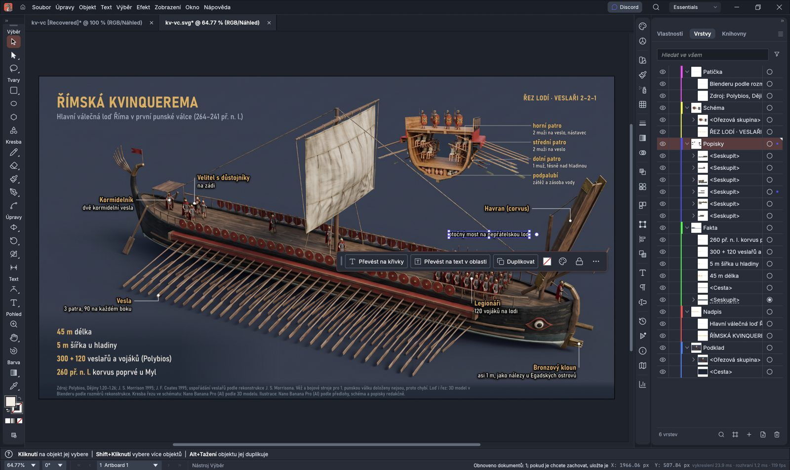

# Infografika z Studia ve VectorCraftu 0.13.1 (2026-10-31)

Skutečná infografika „Římská kvinquerema“ (`20261023-133046-2ea6`), SVG z rendereru Studia. 0 USD.

Snímek je z dřívější verze se šesti plochými vrstvami, před rozdělením na Grafika a Texty.

| Otázka | Výsledek |
|---|---|
| Otevře se? | Ano, 0 varování, 75 objektů |
| Text živý? | Ano, 29 textových objektů; `text.setText` přepsal „Korvus“, `object.move` posunul jen jeden drobný text o 60 px |
| Česká písmena | V pořádku, žádná chybějící písma ani znaky |
| Masky, přechody, halo | Vzhled sedí s Chromiem |
| Písmo beze změny | Text o 15 % širší (`font-stretch` se ignoruje): 552,9 proti 482 px na zkušební větě |
| `Bahnschrift SemiCondensed` + `Bold SemiCondensed` | 480,7 px, tučné zůstává |
| Vrstvy bez úpravy | Jedna „Layer 1“ s nepojmenovanými skupinami |
| Vrstvy po úpravě | `Grafika` (Podklad, Lišta, Vodítka, Schéma), `Texty` (Nadpis, Fakta, Popisky, Popisky schématu, Patička) |
| Render v Chromiu před a po rozdělení | 0 odlišných pixelů z 2 073 600 |
| Uložení přes SVG | Funguje, s varováním, že SVG nedrží vše jako nativní formát (`.vectorcraft`) |

Nezměřeno: souběh otevřeného okna s FLUX na GPU. Log ukazuje, že okno kreslí na integrované Intel UHD, ne na RTX 4060, takže střet o VRAM je nepravděpodobný, ale nezkoušel jsem ho.

Ruční úprava v okně: operátor 31. 10. vyzkoušel, „zdá se to v pořádku“, a doplnil oddělené nadřízené vrstvy pro grafiku a texty.
