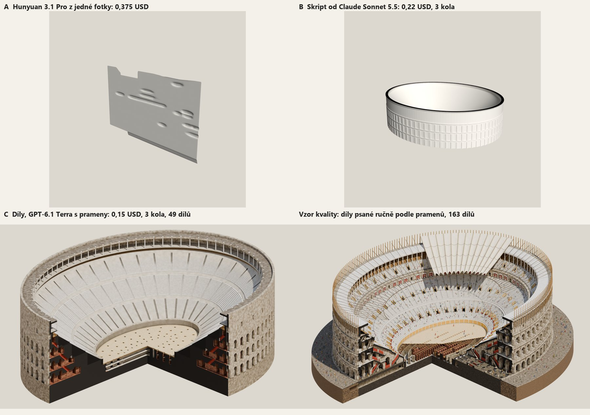

# Cesty k modelu stavby: měření 3a na Koloseu (2026-11-01)

Stejný dossier `library/research/koloseum-v3`, tři cesty z [plánu](../plans/2026-11-01-infografika-z-tematu.md). Výstupy leží v `library/3d-srovnani/koloseum-*` (mimo git).

## Rozhodnutí

Operátor: stavby se dělají z dílů s modelem GPT-6.1 Terra (DECISIONS 2026-11-01). Ruční popis ze spodního pravého obrázku je vzor kvality, ne výstup automatiky.

## Měření

| Cesta | USD | Kola | Výsledek |
|---|---:|---:|---|
| A Hunyuan 3.1 Pro, jedna fotka | 0,3750 | 90 s | plochá deska: šířka/délka 0,016 proti 0,827 (−98 %), výška/délka +135 %, reliéf, nepoužitelné |
| B Skript, Sonnet 5.5 | 0,2184 | 3 | kolo 1 odmítnuté (`__import__`), kolo 3 smazalo hypogeum, 202 úlomků, hladký válec bez oblouků |
| C Díly, Sonnet, první kontrola | 0,0865 | 2 | 8 dílů, arkády nic neprořízly a kontrola prošla (chyba kontroly) |
| C Díly, Terra, první kontrola | 0,0807 | 3 | 25 dílů, je to Koloseum |
| C Díly, Sonnet, opravená kontrola | 0,1049 | 2 | 10 dílů, chudé, plný klín |
| C Díly, Terra, opravená kontrola | 0,0259 | 1 | 29 dílů, dobré |
| C Díly, Terra, rozšířená stavebnice | 0,0283 | 1 | 29 dílů, 6 m pod zemí |
| C Díly, Terra + prameny | 0,0485 | 1 | 47 dílů, sám si odřízl klín (chyba zadání, opravená) |
| C Díly, Sonnet + prameny | 0,4033 | 3 | ani jednou se nepostavil, každé kolo chyba v popisu |
| C Díly, Terra + prameny, opravené zadání | 0,1533 | 3 | 49 dílů, kontrola bez problémů, rozměry 188 × 155,5 × 48 m, 13 m pod zemí |
| **Celkem** | **1,5248** | | |

Součet je z `vysledek.json` běhů plus pevná cena Hunyuanu. Prameny stojí víc: vstup 17 až 27 tisíc tokenů za kolo proti 8 tisícům v původním odhadu, proto byl odhad 0,114 USD pod skutečností 0,1533 a 0,228 USD pod 0,4033. Odhad s prameny je teď zvlášť.

Render `ctvrt` na GPU: 18 s u 49 dílů (1600 × 1000, 48 vzorků), 38 s u 163 dílů (2400 × 1500, 96 vzorků), 0 USD.

## Co ukázaly pohledy, ne čísla

- **Kontrola nepoznala rozbitý model.** Arkády s `osy [0, 0]` nic neprořízly a rozměry i kontakt prošly. Teď je `rezy_bez_ucinku` chyba, podle objemu před a po řezu.
- **Kontrola výšky nutila modely mazat podzemí.** Teď se výška měří od z = 0, podzemí je zvlášť `pod_terenem_m`.
- **Věta v zadání „model se ukazuje v řezu“ způsobila, že si Terra půlku stavby odřízla.** Teď „model je vždy celá stavba, řez dělá až render“.
- **Nejlepší automatický běh je dobrý základ, ne hotová kresba.** Má správná patra, uličky a podlahu arény, ale plný černý klín místo prostoru pod hledištěm a podzemí jen v náznaku.

## Stavebnice po připomínkách operátora

Operátor k modelu: „Na obrázku by měly být patrné i jemnější detaily konstrukce podlaží“, „chybí tam podzemí“, „Doufám, že bude vidět i více z vnější strany“, „v oněch arkádách stály sochy, na části by měly být plachty“, „malí lidičkové tomu také dodají hned lepší náboj“, „To podzemí je navíc hodně zjednodušené“. Vzorem byly jeho dva obrázky.

Nové druhy (`engine/parts_spec.py`, 0 USD, popis zůstává data, žádný kód):

| Co bylo vidět | Čím se to řeší |
|---|---|
| plný klín pod hledištěm | tenké hlediště `tloustka`, radiální stěny `pricky`, schodiště se stupni v profilu |
| hypogeum jako soustředné prstence | řady cel `rada` se zrcadlením, dveře `otvory`, výtahy `zdvihadla` |
| bez oživení | `sochy` (i v aedikule), `lide`, `plachty` se sítí lan; do rozměrů ani kontaktu se nepočítají, v `zdroje` je napsané, co je vymyšlené |
| málo z fasády | pohled `ctvrt` odřízne jen čtvrtinu, `sokl` nechá půdorys pilířů, `odkryv` odebere v jednom obraze výsek písku a podlahy |
| terén | díl s `okoli` se do rozměrů nepočítá |
| rozbité rozměry v řezu | plocha řezu `rez`: `kamen`, `cerna`, `tmava`, po dílech |

Popis Kolosea: `scripts/3d/dily/koloseum.py`, skladba řezu odečtená po metrech ze sítě přes operátorův řez, hypogeum z půdorysu AmphitheatrumFlavium. `lod_check` bez problémů, 190,2 × 157,7 × 48,5 m (římsy 1,1 m přes fasádu), 13 m pod zemí.

## Meze

- **Přesnost je řád metrů.** Hloubka hypogea je odhad, zdroje ji neuvádějí; rozdělení 80 výtahů na 48 + 32 je odhad podle půdorysu.
- **Plachty a lidé jsou oživení obrazu.** Tvar plachet má oporu v anglickém hesle (síť lan, otvor uprostřed), rozmístění je vymyšlené a v popisu to tak stojí.
- **Terra s novou stavebnicí neměřená.** Zadání nové druhy popisuje, placený běh čeká na souhlas operátora, takže nevím, jestli je model umí použít. Ruční popis stojí práci session, ne tokeny modelu, ale automatické to není.
- **Stavba z pramenů je jeden objekt.** Na jiné stavbě než na Koloseu a Pantheonu nezměřeno.
