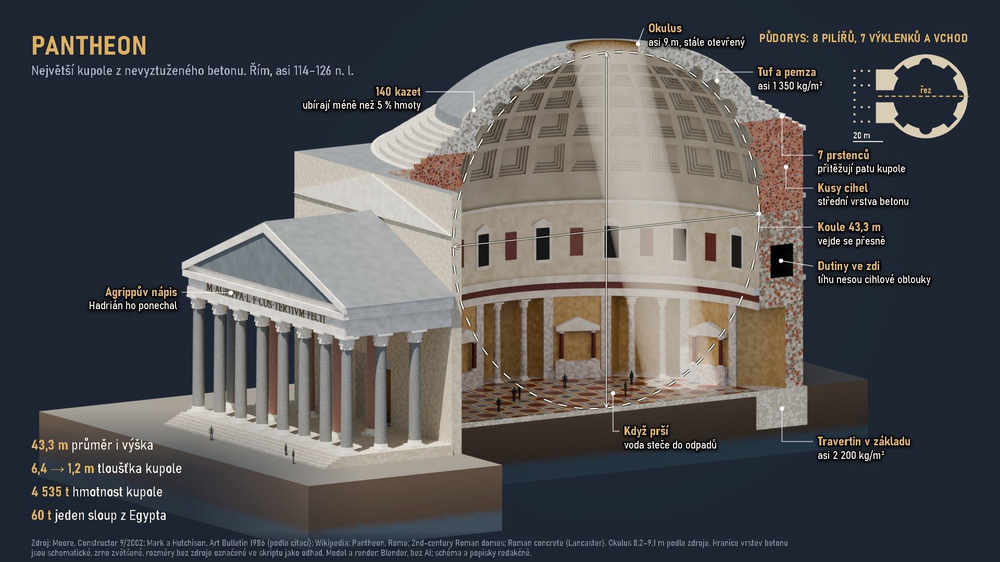
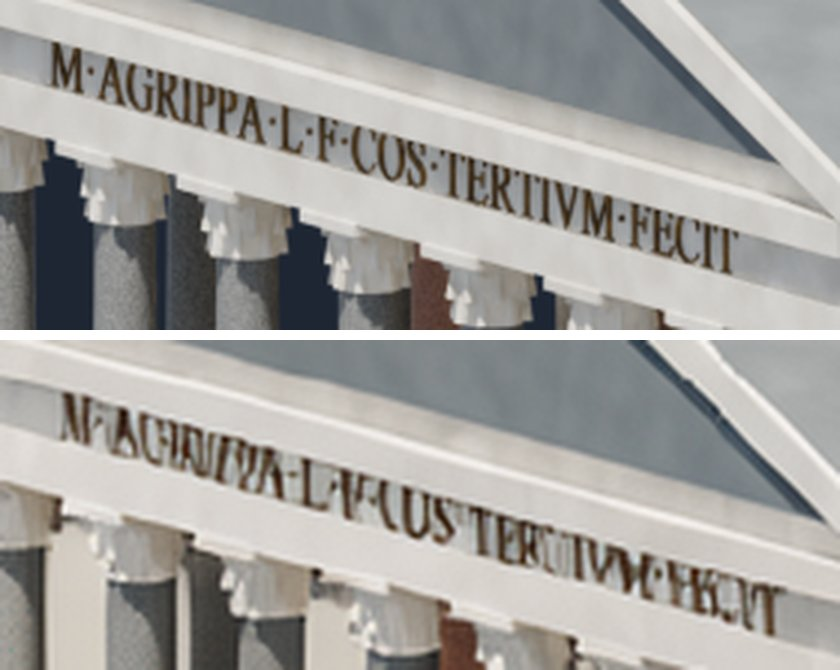

# Spike 2026-11-01: infografika Pantheonu podle cizího vzoru

Operátor vložil cizí infografiku Pantheonu (plakát 2:3, podpis LeoDavinciWave, generovaný AI) s otázkou, jestli ji umíme složit, jakým postupem, a ať ji zkusím vylepšit. Vzor do repa nepatří, není náš.

Závěr: umíme, za 0 USD. Podklad je přímo render modelu z Blenderu, bez AI. Lokální FLUX ho zhoršil. Dokument `20261101-090450-0447` v knihovně operátora, poslední export `20261101-091520.png` a `20261101-091527.pdf`. Texty čekají na kontrolu člověkem (`reviewed_by` prázdné).

## Postup

1. Ověřit fakta vzoru proti zdrojům.
2. Model z rozměrů: `scripts/3d/lod_pantheon.py`, kontrola `lod_check.py` (2 kola).
3. Řez: `blender -b -P scripts/3d/lod_pantheon.py -- out.glb --render DIR` dá `rez.png` a `body.json`. Přes OptiX 1920 × 1080, 96 vzorků, 21 s včetně stavby scény.
4. Podklad: `python scripts/3d/pantheon_infografika.py kompozit DIR` přidá pozadí a kružnici koule přesně z projekce modelu.
5. Dokument: `python scripts/3d/pantheon_infografika.py doc DIR`. Popisky sedí na bodech modelu, po změně kamery se posunou samy.
6. Export v editoru Studia (PNG, PDF), jeden renderer jako u ostatních infografik.

## Co vzor měl špatně a co je tady jinak

| Vzor | Doklad | Tady |
|---|---|---|
| Rozložený pohled má „vnější“ a „vnitřní“ kupoli jako dvě skořepiny | Kupole je jedna skořepina (Moore 2002) | Řez ukazuje jednu skořepinu, tloušťka z 6,4 m na 1,2 m |
| 6 a víc řad kazet | 5 řad po 28, celkem 140 (Moore 2002, Wikipedia) | 5 řad po 28, každá kazeta 4 stupně, generuje skript |
| Kóta „43,3 m“ přes průčelí portiku | 43,3 m je průměr rotundy | Kóta přímo v rovině řezu, mezi stěnami a od podlahy k vrcholu koule |
| Dole „lava rock“ | Základ s travertinem (Moore 2002), nahoře tuf a pemza; jeden zdroj uvádí čedič, proto `Hranice vrstev schematicky` v patičce | Travertin, kusy cihel, tuf a pemza, s hustotami tam, kde je zdroj |
| „Jedna z největších“ | Pořád největší nevyztužená betonová kupole (Wikipedia) | Podtitulek |
| „Postavil Hadrián“ a vedle nápis M AGRIPPA bez vysvětlení, „118–128“ | Cihlové kolky: začátek za Traiana, Hetland 114; vysvěcení asi 126 (Wikipedia) | „asi 114–126“, popisek „Agrippův nápis, Hadrián ho ponechal“ |
| Podlaha v soustředných kruzích | Mřížka čtverců s kruhy a čtverci, vypouklá, odtoky (Moore 2002, Wikipedia) | Mřížka podle popisu, modul 3 m je odhad |
| Okulus 8,9 m bez výhrady | Zdroje 8,2 až 9,1 m | „asi 9 m“, rozpětí v patičce |
| Text vypálený v obraze, anglicky, bez zdrojů, 43,3 m třikrát | Zásady: text nikdy z modelu | Editovatelné vrstvy, česky, zdroje v patičce, jedno vyprávění místo 8 stejně velkých panelů |

Přibylo, co ve vzoru není: koule 43,3 m, která se vejde přesně; kazety ubírají méně než 5 % hmoty; 7 prstenců a dutiny ve zdi; půdorys s 8 pilíři a čarou řezu; postavy 1,72 m pro měřítko.

## Měření

| Kontrola | Práh | Výsledek |
|---|---|---|
| délka vodítka, medián | ≤ 6 % | 4,9 % (první verze 7,9 %, editor ji odmítl) |
| křížení vodítek | 0 | 0 |
| popisek do 40 znaků | všechny | všechny (první verze 9 z 10 delších) |
| prázdná plocha | orientačně ≤ 30 % | 39,2 %, stejně jako kvinquerema 39 %; pozadí kolem stavby, popisky a fakta už do něj nepřidávají prázdný pás |
| `lod_check`: rozměry | ±5 % | 79,7 × 56,9 × 48,8 m proti 79,5 × 56,5 × 48,8 |
| `lod_check`: díly bez kontaktu | žádný | nesplněno: vypsaná hlášení jsou hlavně písmena nápisu, dalších 1 266 úlomků kontrola neprošla; díval jsem se jen na pohledy a skončil po 3. běhu (limit postupu) |
| testy `tests/` + `shared/tests` | | 268 passed, 2 skipped |

Provenience exportu: `ai_generated: false`, `base_provenance.render: Blender`, patička „Model a render: Blender, bez AI; schéma a popisky redakčně.“

## Lokální FLUX přes render

Dva pokusy, `ng-infografika-3d`, render jako `geometry`, 1344 × 768, 257 s, 0 USD (`20261101-091011-2752ea`). Geometrie drží, ale:

- nápis se rozpadl („M AGRIPA … FICIT“), nahoře render, dole FLUX: 
- zmizel paprsek z okulu a pozadí zesvětlelo,
- díly se posunuly, takže popisky a kružnice koule by neseděly,
- proluky mezi sloupy se zaplnily krémovou plochou.

Celý obraz: [FLUX](img/2026-11-01-pantheon-flux.jpg). Placená malba se nezkoušela, odhad z Engine `fal-ai/nano-banana-pro` 1920 × 1088 je 0,15 USD za obrázek, souhlas operátora chybí.

## Co zůstává

- Texty a čísla zkontroluje člověk před zveřejněním. Editor hlásí „není v termdb“ u slov Okulus, kazet, prstenců, cihel, Dutiny, Travertin, základu, Agrippův a „nejednoznačné“ u slova voda; tuhle část jsem neprocházel.
- Mark a Hutchison 1986 ani Lancaster jsem nečetl v originále, jen přes citace. Hranice vrstev betonu a hustoty mezi základem a vrcholem jsem v dostupných zdrojích nedoložil, proto jsou v obraze jen dvě krajní hustoty.
- Rozměry portiku a výšky říms jsou `odhad`. Vnitřní výzdoba je zjednodušená: rozmístění výklenků a edikul odpovídá popisu, jednotlivé mramory ne.
- Vzhled je čistý technický render, malířská bohatost vzoru tu není.

## Zdroje

- D. Moore, *The Pantheon*, Constructor 9/2002: [PDF](https://www.ancientportsantiques.com/wp-content/uploads/Documents/ETUDESarchivees/Ma%c3%a7onnerie/B%c3%a9tonRomain/RomanConcretePantheon-Moore2002.pdf)
- Wikipedia: [Pantheon, Rome](https://en.wikipedia.org/wiki/Pantheon,_Rome), [2nd-century Roman domes](https://en.wikipedia.org/wiki/2nd-century_Roman_domes), [Roman concrete](https://en.wikipedia.org/wiki/Roman_concrete)
- [Newton Excel Bach: The Dome of the Pantheon](https://newtonexcelbach.com/2008/05/24/the-dome-of-the-pantheon/) (cituje Mark a Hutchison 1986)
