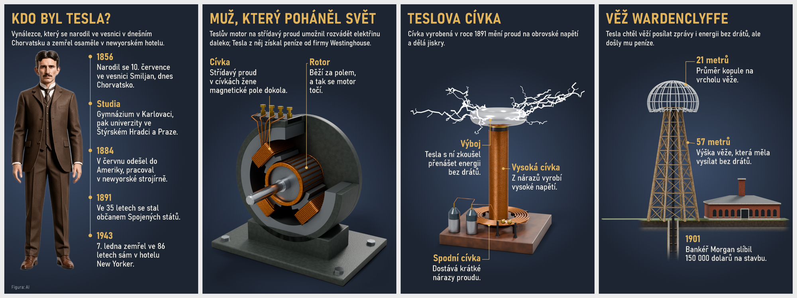

# Krok 3g: série stránek pro telefon (2. 11.)

Co vzniklo: z vybraného návrhu série stránek. Text přepisuje model z faktů dossieru, rozvržení počítá kód, obraz je vlastní 3D. Zásady: [`docs/infografiky-zasady.md`](../infografiky-zasady.md), oddíl Logika stránky.

## Opravdový běh na `nikola-tesla-v3`

Řetězec `20261102-213008-7012`, karty v kroku Stránky opravdového Studia.

| Karta | Formát | Titulek | Popisek a text | Prázdná plocha | Nález o mobilu | Co se nevešlo |
|---|---|---|---|---|---|---|
| Kdo byl Tesla? | 1080 × 1620 | 82,8 px | 54 a 46 px | 5 % | žádný | nic |
| Muž, který poháněl svět | 1080 × 1620 | 82,8 px | 54 a 46 px | 9 % | žádný | Niagara, 1888 |
| Teslova cívka | 1080 × 1620 | 82,8 px | 54 a 46 px | 13 % | žádný | 1891 |
| Věž Wardenclyffe | 1080 × 1620 | 82,8 px | 54 a 46 px | 16 % | žádný | Došly peníze, Marné prosby |

**Co stálo peníze, ze schválených 0,30 USD:**

| Krok | USD |
|---|---|
| Návrhy, Sonnet, 11 596 a 3 245 tokenů | 0,0556 |
| Kontrola logiky, Opus, dvakrát | 0,0472 + 0,0611 |
| Texty 2 stránek, zadání „zkrať fakt“, stránky v koši | 0,0134 |
| Texty 4 stránek, dva běhy | 0,0230 + 0,0234 |
| Tři přímé zkoušky textů mimo ledger Engine | 0,0455 |
| **Celkem** | **0,2692** |

Co jsem udělal ručně a neprošlo řetězcem:

- Vybraný návrh měl jen motor a životopis. Cívku a věž jsem do něj přidal v `workflows/<id>.json` z faktů, které model vybral do jiného návrhu. Kontrola logiky je neviděla.
- Poslední složení je stejný kód (`serie.write_texts`, `page_fields`, `POST /infographics/panels`) nad texty posledního placeného běhu, 0 USD. Tlačítko by stálo odhadem 0,036 USD a překročilo by schválenou cenu. Naostro běželo dvakrát, před poslední opravou skladatele.
- Názvy částí cívky (`obrazy.json`) a bod věže (`vez/body.json`) v knihovně jsem změnil přímo, bez nového renderu. Totéž dělá `scripts/3d/tesla_tema.py`.

**Zadání návrhů pro 4 stránky** běželo jen přes subagenta (Sonnet, placené API ne, jeden běh): 3 návrhy po 4 stránkách, první stránka s figurou, každá stránka má vlastní hlavní obraz, neznámá a opakovaná fakta 0, 29 kB JSON, asi 10 000 tokenů výstupu. Podle toho je odhad návrhů 0,134 USD a řetězce 0,24 USD. Skutečná cena placeného běhu není změřená.

## Ukázka, ruční text, 0 USD

Stránka 1080 × 1350. Údaje z `panels.checks` a `serie.compose`.

| Stránka | Slov z asi 80 | Největší prázdná plocha | Splývá s pozadím | Nález o mobilu |
|---|---|---|---|---|
| Nikola Tesla, osa života | 40 | 3 % | ne | žádný |
| Motor bez kartáčů | 29 | 17 % | ne | žádný |
| Cívka a blesky | 28 | 8 % | ne | žádný |
| Věž Wardenclyffe | 32 | 17 % | ne | žádný |

Operátor k téhle verzi: „Ano, to je výrazně lepší.“

## Čím se měří

**Prázdná plocha** (`panels.empty_share`): největší prázdný obdélník pod titulkem jako podíl té plochy, obraz obsazuje jen tam, kde není průhledný. Práh 20 %. Stránka motoru, na kterou operátor reagoval, dává podle přesnosti rekonstrukce 27 až 37 %.

**Splývání** (`panels.faint_parts`): 80. percentil kontrastu proti stránce po 8 pásech obrazu, měří se jen objekt. Tenká část (plných pixelů pod 20 %) chce 2:1, plocha 1,2:1. Práhy jsou podle jediné série, na jiném tématu můžou chybět nebo přebývat.

| Obraz | Nejslabší pás (plnost, kontrast) | Nález |
|---|---|---|
| věž s tmavou kupolí | 0,09, 1,67:1 | horní část |
| věž se světlou kupolí | 0,55, 3,99:1 | žádný |
| motor | 0,29, 1,97:1 | žádný |
| turbína | 0,60, 1,32:1 | žádný |
| figura | 0,42, 1,49:1 | žádný |

**Co stroj nezměří:** že je podloží největší. Tomu pomohla jen příprava obrazu a prohlídka v plné velikosti.

## Staré dokumenty se nezměnily

- Panelové dokumenty: SVG všech 4 v knihovně je podle kódu masteru `1c2a39f` a větve shodné bajt po bajtu (SHA-1). Před odstraněním Rozdělit pro mobil totéž na 8 dokumentech proti `7b89a2f`. Řádek Zdroj zmizel ze starých dokumentů už na masteru (GRAFIK#162), rozhodnutím operátora.
- Editor: `svg.info-svg` dvou starých dokumentů (`20261101-090450-0447`, 10 popisků a 4 fakta; `20261023-133046-2ea6`) je mezi Studiem masteru a větve shodné (SHA-1). Přibyl jen řádek v Kontrole: titulek 9,6 px, nejmenší text 3,9 px, označení AI 3,1 px na telefonu.

## Proklikáno ve Studiu za 0 USD

Engine z větve s falešným modelem a dočasnou knihovnou, Studio přes `GRAFIK_ENGINE_URL`: návrhy se stránkami a zaškrtávátky, výběr, kontrola, Složit stránky, tři náhledy šířky 360 px s kontrolou. Konzole bez chyby. Nový dokument v editoru má `pismo: "mobil"` a řádek „písmo čitelné i na mobilu“.
