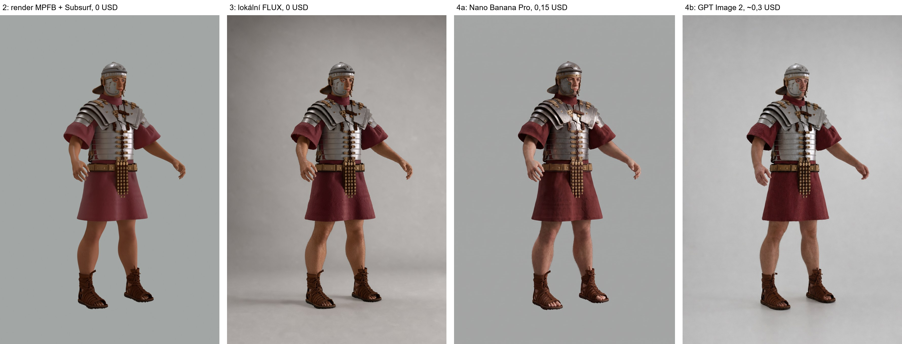

# Legionář: vzhled těla, rukou a pleti (varianty 2–4), 2026-11-06

Výchozí stav: postava s kostrou, tělo MPFB, výstroj po dílech (běh B30, sukně do áčka, obrys sedí na předlohu zepředu i zboku). Ruce a pleť MPFB vypadaly jako panenka (operátor: „děsné“).

| Varianta | Co | Cena | Ruce | Obličej, pleť | Shoda s 3D (výstroj, póza, výřez) |
|---|---|---|---|---|---|
| 1 | MPFB bez úprav | 0 | děsné | plast | přesná (zamítnuto operátorem) |
| 2 | MPFB + Subsurf (render 2), prsty pokrčené (osa X+, 20/30/20°, palec poloviční) | 0 | uvolněné, nehty, výrazně lepší | oranžová, voskově hladká, panenka | přesná |
| 3 | render 2 → lokální FLUX (role `geometry`), 768×1152 | 0 | dobré, chlupy | lepší, ale malované, malé rozlišení | dobrá |
| 4a | render 2 → Nano Banana Pro edit, 3 obrázky | 0,15 / ks | jako fotka | jako fotka | výstroj drží; 2 ze 3 změnily výřez a pozadí |
| 4b | render 2 → GPT Image 2 edit (`quality: high`), 2 obrázky | ~0,33 / ks (účtuje tokeny, odhad) | jako fotka | skoro fotka | pixelově přesná, stejný výřez |

Utraceno 1,11 USD (`library/costs.jsonl`, `caller` = `legionar-var4`), schváleno ~1,10 USD. Skripty: `scratchpad` session (var2.py, var3.py, var4.py).

## Závěr: hybrid

1. **Tvar, póza a výstroj z vlastní 3D postavy** (kostra, díly z generátoru, simulovaná tunika). Je to jediná cesta, která drží stejného vojáka ve všech pózách a dá měřítko pro infografiku a pohyb pro klipy.
2. **Render už se Subsurf a pokrčenými prsty** (varianta 2 do hlavního skriptu).
3. **Povrch dělá model obrazu nad renderem:**
   - náčrt a výběr pózy: lokální FLUX, 0 USD;
   - finální obraz, kde popisky míří na místa (infografika): GPT Image 2, drží každý plát i výřez;
   - finální ilustrace, kde rozhoduje dojem: Nano Banana Pro, nejvěrnější fotka; výsledek se změněným výřezem vyřadit.
4. Daz (varianta 5) jen jako čistý render bez AI, licence AI vstup zakazuje. Tělo Anny a MetaHuman: samostatné sessions.
